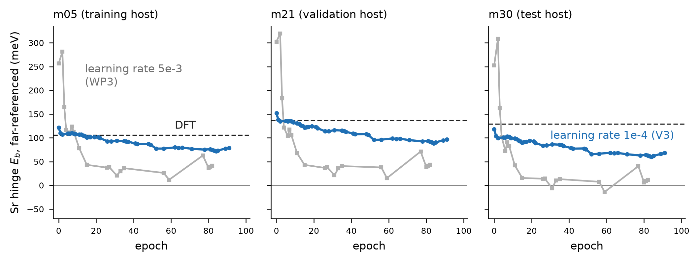

# WP3 re-tests V1, V1b, V2 and V3 — does a change of fine-tuning recipe keep the Sr–vacancy repulsion? (2026-11-17)

File names are relative to `results/objective2/dopant_shell/wp3_retests/`, except `scripts/NN` (the repository's
numbered scripts). Text in block quotes is quoted from the pre-specifications and keeps their file names.

> **Addendum, 2026-11-19.** Two further arms, V5 (V3 with another seed) and V4 (learning rate 1e-3), are reported in
> `WP3_RETESTS_V4V5.md`. They leave the readings below unchanged, with one qualification: at the rate of V3 a second
> seed is classed "lost" where V3 is "partial", so that class is not stable under the seed.

## 1. Summary

WP3 (`../WP3_RESULT.md`) fine-tuned the MACE-MP-0 medium model on 201 DFT frames. The force RMSE on the 46 m30/m32
test frames fell from 86.81 to 14.94 meV/Å, but the far-referenced Sr E_b error RMS on m30 rose
from 9.20 to 88.71 meV. Four re-tests of the recipe were pre-specified one after another and run
locally on CPU; each changes the WP3 recipe in a stated way (§2).

All four are **post hoc with respect to WP3 and diagnostic only**: the WP3 test set had been used, so no model here
is adopted on this evidence (V1_PRESPEC, opening paragraph).

| Re-test | Change to the WP3 command | P1 (meV) | P3 (meV/Å) | Reading by its pre-specified rule |
|---|---|---|---|---|
| zero-shot (ZS) | – | 9.20 | 86.81 | reference |
| WP3 | – | 88.71 | 14.94 | reference |
| V1 | energy weight 7 × 10⁴ → 6.7 × 10⁶ | 98.61 | 33.14 | **collapse persists** (P1 > 50 meV) |
| V1b | V1, and the 24 vacancy-free MD/rattle frames at energy weight 0 | 125.62 | 21.35 | **collapse persists** (P1 > 50 meV) |
| V2 | multi-head replay protocol (2000 replay samples) | 15.17 | 49.95 | **collapse avoided** (P1 ≤ 25 meV); counted as **under-trained** by the caution of V3_PRESPEC (P3 > 45 meV/Å) |
| V3 | learning rate 0.005 → 1e-4 | 47.04 | 15.76 | **partial**; the checkpoint trajectory is reported (P1 neither ≤ 25 nor > 50 meV; P3 ≤ 45 meV/Å) |

P1 is the error RMS of the far-referenced Sr E_b over the 3 non-far m30 Sr sites. P3 is the force RMSE over the 46
m30/m32 test frames. Both are on the raw F basis, as criterion 6 of WP3.

- **V1 and V1b: neither change of energy weighting restores the repulsion.** At the m30 Sr hinge (DFT
  +129.4 meV) the models give +1.1 (V1) and -40.9 meV (V1b), against +11.6 (WP3) and
  +123.0 meV (zero-shot). The WP3_RESULT §8 reason 1 (dilution of the energy weight by the off-equilibrium
  frames) is refuted as the explanation of the collapse.
- **V2: the repulsion is kept, with forces improved only part of the way.** The m30 Sr hinge and flank E_b are
  +133.4 and +121.5 meV (DFT +129.4 and +95.6). P3 fell to 49.95 meV/Å, that is to 0.575 of
  the zero-shot value, against 0.172 for WP3. V3_PRESPEC, written before V2 was read, fixed that such a V2 counts
  as under-trained.
- **V3: partial.** With only the learning rate lowered, P3 is 15.76 meV/Å (WP3 14.94) and P1 is
  47.04 meV. The m30 Sr hinge and flank E_b are +68.5 and +42.5 meV. P1 lies 2.96 meV below the
  50 meV line of "not the learning rate"; it rests on 3 sites of one host and one seed (§6).
- **The joint rule for V2 and V3 returns no attribution.** None of its three branches (learning rate; replay;
  data or targets) is met (§6). The cause of the collapse is not identified by these re-tests.
- **Limits.** One seed per arm; a test set that had been used; P1 rests on 3 sites of one host; in V2 the learning
  rate, the EMA and the replay change together (§9).

Every number in this note is copied by code from the json or csv file named beside it, unless a log or note is
named. Values are rounded here; `wp3_retests_table.csv` holds the table values at full precision (§10).

## 2. What was run

**Data.** The WP3 dataset as committed: `../wp3/dataset/train.xyz` (201 frames), `valid.xyz` (31 frames, host m21),
`test.xyz` and `E0s.json` (`../wp3/dataset/dataset_meta.json`, field `n`; hosts in field `hosts`). V1b alone uses a
modified copy of `train.xyz` (§4).

**Software.** mace-torch 0.3.16, torch 2.14.1, e3nn 0.4.4, ase 3.29.0, Python 3.12, float64 on CPU
(`V1_LOG.md`, line 6).

**Models.**

| Name | Model | Selected epoch | sha256 | Source of the sha256 |
|---|---|---|---|---|
| ZS | MACE-MP-0 medium, `20231203mace128L1_epoch199model` | – | `01bfe22100139f424713cf921144e5509cbe353d67aa9fa1be9c6e1e0ed35845` | `V1_LOG.md`, line 4 |
| WP3 | `../wp3/run2/wp3.model` | 82 | `3f7bf6f5aaaadc72d3954b56dfe3b7bcf5878b0f1be0c115e56c8bcaec65d2ca` | `../WP3_RESULT.md` §2 (not in `V1_LOG.md`) |
| V1 | `run_v1/wp3v1.model` | 64 | `9827174aa284587a49880476291db220ea959da3a9c78ee4cf502ff4e18fda59` | `V1_LOG.md`, lines 18–19 |
| V1b | `run_v1b/wp3v1b.model` | 77 | `3ea731ecc87a39ab414e54e0cddde6a0504364935d9ca792ac2c1dbe1a16e6a2` | `V1_LOG.md`, lines 38–39 |
| V2 | `run_v2/wp3v2.model` | 99 | `7fcccdc53d677ceaa48485b0187b28718a098e5b2b2c45b133972b0881176efc` | `V1_LOG.md`, lines 65–66 |
| V3 | `run_v3/wp3v3.model` | 91 | `71b5d99e1140d81559cebf7b5ffa9700a5c71a678c5dac5a0c26c3e654550cba` | `V1_LOG.md`, line 81 |

The selected epochs of V1, V1b, V2 and V3 are those of the lines "Loaded Stage one model from epoch N" at the end of
each `run_*/logs/*_run-123.log` (last 40 lines, read by code). The selection is mace-torch's own (lowest validation loss on m21).

**Training commands.** The four local commands (`run_v1/`, `run_v1b/`, `run_v2/`, `run_v3/`, file
`train_command.txt`) were compared flag by flag by code. Apart from `--name`, `--work_dir` and the differences
listed below, they are identical:

```
mace_run_train --seed 123 --device cpu --default_dtype float64 --foundation_model <foundation file>
  --multiheads_finetuning False --train_file ../wp3/dataset/train.xyz --valid_file ../wp3/dataset/valid.xyz
  --E0s ../wp3/dataset/E0s.json --energy_key REF_energy --forces_key REF_forces --loss weighted
  --energy_weight 70000.0 --forces_weight 100 --optimizer adam --amsgrad --lr 0.005 --weight_decay 5e-7
  --clip_grad 10 --scheduler ReduceLROnPlateau --lr_factor 0.8 --scheduler_patience 50 --ema --ema_decay 0.99
  --batch_size 2 --valid_batch_size 2 --patience 2048 --eval_interval 1 --keep_checkpoints --max_num_epochs 100
```

| Arm | Flags that differ from the block above |
|---|---|
| V1 | `--energy_weight 6700000.0` |
| V1b | `--energy_weight 6700000.0`; `--train_file v1b/train.xyz` |
| V2 | `--multiheads_finetuning True`; added `--pt_train_file mp --num_samples_pt 2000 --filter_type_pt combinations --atomic_numbers [1,6,7,38,53,55,82]` |
| V3 | `--lr 0.0001` |

The block above is the WP3 recipe as `../WP3_RESULT.md` §2 item 5 describes it (weighted loss with w_E 70000 and
w_F 100; Adam with AMSGrad, lr 0.005, weight decay 5e-7, clip 10; ReduceLROnPlateau with factor 0.8 and patience
50; EMA 0.99; batch 2, 100 epochs, seed 123, `--keep_checkpoints`; `--multiheads_finetuning False`). The node's
own command file of WP3 was not opened for this note. The equality of the local command with the WP3 run rests
on gate G-train (below).

**Evaluator.** `eval_v1.py` recomputes the criterion-6 quantities of `scripts/39` from the DFT labels
stored in `test.xyz` and `valid.xyz` (`REF_energy_raw`, `REF_forces`); it opens no QE output. Fine-tuned models
are evaluated on the head "Default". `eval_retests.py` is a relocatable copy (§10).

**Gates, passed before any V1 value was read** (V1_PRESPEC §3; `V1_LOG.md`, lines 7–11).
- **G-train.** The unchanged WP3 command, run locally, gave the Initial validation loss 0.33213836 and the
  epoch-0 validation loss 9.66622193, "both equal to run2's log to all printed digits".
- **G-eval.** On ZS and WP3 the evaluator reproduces criterion 6 (i), (ii) raw and (iii) raw (all, Sr, GA) of
  `../wp3/wp3_eval.json` (`geval.json`). Re-checked for this note by code against `criterion6.values`: the largest
  difference in the ten values is 2.5 × 10⁻⁸ (meV/Å, in (i)); the other eight are equal to the last digit.

## 3. V1 — energy weight computed from the band and binding frames alone

**Pre-specification:** `V1_PRESPEC_2026-11-15.md`, "Written 2026-11-15, before any V1 training step or V1
value exists."

**Question and hypothesis** (§1, quoted):

> WP3_RESULT §8 reason 1: the w_E rule of amendment m item 2 balanced the loss terms over all 130 energy-labelled
> frames, of which the 24 vacancy-free MD/rattle frames carry 99.7 % of L_E (multi-eV zero-shot residuals). w_E came out
> about 95 times lower than the 6.7 × 10⁶ that the same rule gives over the 106 band and binding frames alone.
>
> **H1.** With w_E = 6.7 × 10⁶ (everything else identical), the Sr far-referenced E_b does not collapse.

**Arm** (§2, quoted): "the WP3 command with `--energy_weight 6700000.0` and a new work directory; nothing else
changed". The command file confirms it (§2, training commands).

**Read-outs** (§4, quoted):

> - **P1 (primary):** Sr far-referenced E_b error RMS over the 3 non-far m30 Sr sites (hinge 136, flank 124, mid 52;
>   far site 64).
> - P2: (iii) over all 5 non-far m30 sites. P3: (i) force RMSE over the 46 m30/m32 frames. P4: (ii) dE_a RMS over the
>   4 m30/m32 pairs.
> - Reported only: per-site errors and signs; m21 site errors (validation host, used for selection, not independent).

**Reading rule** (§5, "fixed now", quoted):

> - **Collapse removed by the energy weight:** V1 P1 ≤ 25 meV and V1 P3 < 86.81 meV/Å.
> - **Collapse persists:** V1 P1 > 50 meV. Claim 4 then stands for two energy weights.
> - **Partial:** anything else; V2 then decides.
> - If V1 P3 ≥ 86.81 meV/Å, this is reported as a force-energy trade-off whatever P1 reads.

**Result** (`v1_eval.json`; selected epoch 64).

| | ZS | WP3 | V1 |
|---|---|---|---|
| **P1** (meV) | 9.20 | 88.71 | **98.61** |
| P2 (meV) | 28.41 | 69.38 | 77.33 |
| P3 (meV/Å) | 86.81 | 14.94 | 33.14 |
| P4 (meV) | 23.65 | 32.76 | 47.89 |

- m30 Sr hinge (DFT +129.4 meV): V1 +1.1 meV. Sr flank (DFT +95.6): V1
  -17.0 meV, with the sign lost. All sites of m30 and m21 are in §7.
- `V1_LOG.md` (line 22) and V1B_PRESPEC print P1 as 98.62 meV. The json value is
  98.6149 meV, which rounds to 98.61. `V1_LOG.md` (line 74) now records the correction.
- Epoch 99 did not improve the validation loss and was not kept, so the pre-specified "final epoch (99)" does not
  exist. By a ruling logged before any V1 test value (`V1_LOG.md`, lines 13–16) the last kept checkpoint stands in
  for it; that is epoch 64 itself, so V1 has one model.

**Reading by the rule: "Collapse persists"** (P1 = 98.61 > 50 meV). H1 is refuted. "Claim 4 then stands for two
energy weights." P3 = 33.14 < 86.81 meV/Å, so no force–energy trade-off is flagged. By §6 of the
pre-specification, differences in P1 smaller than about 20 meV are not interpreted: V1 is not read as worse than WP3
(the difference is 9.91 meV).

**Post hoc** (not pre-specified; §8): D-V1a on the training host m05 and D-V1b on the cancellation of per-cell
errors.

## 4. V1b — the 24 vacancy-free MD and rattle frames at energy weight 0

**Pre-specification:** `V1B_PRESPEC_2026-11-15.md`, "Written 2026-11-15 ~11:40Z, after the V1 result
(collapse persists, P1 98.62 meV) and D-V1a/D-V1b, before any V1b step."

**Question and hypothesis** (quoted):

> **Question.** WP3_RESULT section 8 names two tests of reason 1. V1 ran the first (w_E from the 106 band and binding
> frames). This is the second: the 24 vacancy-free WP3 MD/rattle frames, which carry 99.7 % of the initial energy loss,
> get `config_energy_weight = 0` (forces kept). D-V1a shows the fine-tuned models fail on their own m05 training
> quartet; if those 24 frames pull the Sr-substituted energies, removing their energy term should restore it.
>
> **H1b.** With those 24 frames at energy weight 0 and everything else as V1 (w_E 6.7e6, w_F 100, seed 123, 100 epochs,
> mace-torch selection), the Sr far-referenced E_b does not collapse.

**Arm.** The V1 command with `--train_file v1b/train.xyz` (§2, training commands). The data file is defined so (quoted):

> **Data.** `v1b/train.xyz` = `wp3/dataset/train.xyz` with `config_energy_weight=0.0` added to exactly the frames whose
> config_type is md or rattle and that carry no weight field now (the 24 vacancy-free frames); no other byte of any
> frame changes. valid.xyz and E0s.json unchanged. Checked by a script before training: 24 frames changed, 201 frames,
> positions, labels and forces identical.

`V1_LOG.md` (lines 35–37) records the check ("201 frames, labels/positions/forces/energies identical, 106
energy-labelled") and the Initial validation loss 0.73195413. The file `v1b/train.xyz` was not opened for this note.

**Read-outs and reading rule** (quoted):

> **Outcomes and reading.** As V1_PRESPEC sections 4-5 (P1 primary; thresholds 25 / 50 meV; force flag at 86.81 meV/A),
> plus D-V1a on m05 (reported only).
> - If V1b P1 <= 25 meV: the collapse is caused by the off-equilibrium energy labels (a recipe fix exists).
> - If V1b P1 > 50 meV: neither energy-weight change helps; V2 (multi-head replay) is the remaining recipe test.
> - Otherwise partial.

**Result** (`v1b_eval.json`; selected epoch 77).

| | ZS | V1 | V1b |
|---|---|---|---|
| **P1** (meV) | 9.20 | 98.61 | **125.62** |
| P2 (meV) | 28.41 | 77.33 | 101.17 |
| P3 (meV/Å) | 86.81 | 33.14 | 21.35 |
| P4 (meV) | 23.65 | 47.89 | 39.70 |

- m30 Sr hinge: -40.9 meV (DFT +129.4); Sr flank: -39.7 meV (DFT +95.6). Both signs are lost:
  the model makes Sr attract the vacancy.
- The m30 GA error RMS returns to the zero-shot level (43.79 against 43.49 meV; WP3
  15.16, V1 19.05), and the GA near sign is lost again (§7).
- **Training host m05 (D-V1a, reported only; `diag_trainhost_m05_v1b.json`).** On frames that carry
  energy labels in `train.xyz`, the far-referenced Sr hinge E_b of V1b is +0.5 meV against the raw label
  +105.7 (E′ label +122.0); the flank is +6.0 against +116.1 (E′ +128.7) meV.
  All m05 sites are in §7.

**Reading by the rule: "collapse persists"** (P1 = 125.62 > 50 meV): "neither energy-weight change helps; V2
(multi-head replay) is the remaining recipe test." H1b is refuted. P3 = 21.35 < 86.81 meV/Å, so no trade-off
flag. V1b is worse than V1 by 27.00 meV in P1, above the 20 meV below which differences are not
interpreted.

**Post hoc:** D-V1c (§8).

## 5. V2 — the multi-head replay protocol

**Pre-specification:** `V2_PRESPEC_2026-11-15.md`, "Written 2026-11-15 ~21:45Z, after V1 and V1b (both
"collapse persists") and before any V2 step."

**Question and hypothesis** (quoted):

> **Question.** V1 and V1b changed the energy weighting of the single-head (naive) recipe; neither helped. The MACE
> documentation recommends multi-head replay fine-tuning for MP foundation models, to prevent catastrophic forgetting.
> The zero-shot model reproduces the Sr repulsion (m30 Sr far-ref RMS 9.20 meV). V2 asks whether the recommended
> protocol keeps it while improving forces.
>
> **H2.** Under mace-torch 0.3.16's multi-head replay protocol, the fine-tuned head keeps the Sr far-referenced E_b.

V1_PRESPEC §2 had listed V2 as a secondary arm, to be run only if V1 did not settle H1. It was specified afresh
after V1b, by the rule of V1B_PRESPEC.

**Arm** (quoted):

> **Arm.** The WP3 command (data, E0s.json, w_E 70 000, w_F 100, seed 123, batch 2, 100 epochs, float64, CPU) with
> `--multiheads_finetuning True --pt_train_file mp`, and the protocol's own defaults: learning rate 1e-4, EMA decay
> 0.99999 (mace-torch overrides lr/EMA unless `--force_mh_ft_lr`), replay subselection random, weight_pt_head 1.0.
> Evaluated on the fine-tuning head ("Default"). Replay and the lower learning rate are not separable: V2 tests the
> protocol as a whole.
>
> **Replay size, fixed by cost before any V2 value.** A 1-epoch timing run at num_samples_pt = 10000 (default),
> filter_type_pt none. If 100 epochs project to ≤ 48 h locally, that is V2. Otherwise num_samples_pt = 2000 with
> filter_type_pt combinations (replay configurations whose elements are a subset of H, C, N, Cs, Pb, I, Sr), and the
> choice is recorded in V1_LOG.md before training. The timing run reads only wall time, never a test metric.

What was run, against that text (`V1_LOG.md`, lines 52–61, and `run_v2/train_command.txt`):

- **Replay size.** The timing run at 10 000 samples projected about 135 h for 100 epochs, above the 48 h bound, so
  the pre-specified fallback applies: `--num_samples_pt 2000 --filter_type_pt combinations`. The log states that
  the choice was "Decided on wall time only; no V2 metric was read". Replay: 1800 training and 200 validation MP
  frames.
- **One added flag.** mace-torch refused the first launch because the `combinations` filter needs an element list;
  `--atomic_numbers [1,6,7,38,53,55,82]` (the 7 training elements) was added. The log calls it an infrastructure
  fix: no step had run.
- **Correction of the pre-specification's wording, logged at the start.** The `combinations` filter is not "a
  subset of the training elements": the replay set also contains other elements. V2 is "mace-torch combinations
  replay, 2000 samples", as run.
- **Learning rate and EMA.** The command line still carries `--lr 0.005 --ema_decay 0.99`; the multi-head mode
  overrides them. `V1_LOG.md` (lines 66–68) quotes the run log: line 5 "Multihead finetuning mode, setting learning
  rate to 0.0001 and EMA to True", line 70 "Learning rate: 0.0001". As reported by the project lead, that branch of
  mace-torch 0.3.16 (`mace/cli/run_train.py`, lines 204–210) sets the learning rate to 0.0001, the EMA on and the
  EMA decay to 0.99999. Neither the head of the V2 log nor the mace-torch source was read for this note.
- **Selected epoch: 99, the last one** (`run_v2/logs/wp3v2_run-123.log`). The m21 validation loss of the "Default"
  head was still falling at the end (0.02088583 at epoch 90, 0.01962057 at epoch 99, the lowest of the last ten).

**Read-outs and reading rule** (quoted):

> **Outcomes and reading.** As V1_PRESPEC sections 4-5 (P1 primary: ≤ 25 meV "collapse avoided", > 50 meV "collapse
> persists", else partial; force flag at 86.81 meV/A), plus D-V1a on m05 (reported only). A V2 that keeps P1 ≤ 25 meV
> and P3 < 86.81 meV/A would be the first fine-tuned model worth a fresh-host adoption test.

**A caution fixed before V2 was read.** `V3_PRESPEC_2026-11-16.md` was "Written 2026-11-16 ~13:10Z,
before the V2 result is read (V2 is at about epoch 47 of 100; only its logged validation curves have been seen)".
Its reading rule ends (quoted):

> - With V2: both keep the repulsion with improved forces -> learning rate; only V2 -> replay; neither -> data or targets.
>   A V2 that keeps the repulsion without P3 <= 45 meV/A counts as under-trained (its EMA time constant is about the
>   length of the run).

**Result** (`v2_eval.json`, which holds V2 only; ZS and WP3 are from `v1_eval.json`).

| | ZS | WP3 | V2 |
|---|---|---|---|
| **P1** (meV) | 9.20 | 88.71 | **15.17** |
| P2 (meV) | 28.41 | 69.38 | 15.59 |
| P3 (meV/Å) | 86.81 | 14.94 | **49.95** |
| P4 (meV) | 23.65 | 32.76 | 40.66 |
| m21 all / Sr / GA (meV) | 29.07 / 32.06 / 23.90 | 63.84 / 77.73 / 33.57 | 54.05 / 40.68 / 69.44 |

- **m30 Sr.** Hinge +133.4 meV (DFT +129.4, error +4.0); flank +121.5 meV (DFT +95.6, error
  +26.0); mid +0.9 meV (DFT +1.2). All five m30 signs agree with DFT.
- **m30 GA.** The error RMS is 16.21 meV, against 43.49 zero-shot and 15.16 for WP3.
- **Forces.** P3 = 49.95 meV/Å is 0.575 of the zero-shot value. WP3, V3, V1b and V1 reached
  0.172, 0.182, 0.246 and 0.382 of it.
- **ΔE_a.** P4 = 40.66 meV is above the zero-shot 23.65 meV, as for WP3, V1 and V1b; V3 is the exception (§6).
- **m21 (validation host; reported only).** The GA error RMS is 69.44 meV, worse than zero-shot
  (23.90) and the largest of the six models (WP3 33.57, V1 19.60, V1b 9.94, V3 48.49). V2 puts the
  GA near and GA mid E_b at +107.9 and +94.9 meV, against DFT +36.3 and +27.7 (errors
  +71.6 and +67.2; zero-shot errors +21.5 and +26.1). The m21 Sr error RMS is 40.68 meV
  against 32.06 zero-shot; the m21 Sr hinge and flank keep the repulsion (+163.3 and +165.0 meV; DFT
  +136.7 and +131.7).
- **Training host m05 (D-V1a).** V2_PRESPEC lists it as a reported-only read-out. **No m05 evaluation of V2
  exists** (`V1_LOG.md`, line 73; `diag_trainhost_m05_v1b.json` holds ZS, WP3, V1 and V1b). This pre-specified
  read-out has not been produced.
- **Model.** `run_v2/wp3v2.model`, sha256 in §2 (`V1_LOG.md`, lines 65–66).

**Reading by the rules.**

1. **V2_PRESPEC: "collapse avoided"** (P1 = 15.17 ≤ 25 meV). P3 = 49.95 < 86.81 meV/Å, so no force–energy
   trade-off is flagged. Both conditions of its last sentence hold, so V2 is "the first fine-tuned model worth a
   fresh-host adoption test". H2 is not refuted.
2. **V3_PRESPEC caution: V2 "counts as under-trained"** (it keeps the repulsion without P3 ≤ 45 meV/Å: P3 =
   49.95). In the joint reading of V2 and V3 (§6), V2 therefore does not count as a model that "keeps the
   repulsion with improved forces".
3. **Not interpreted.** V2's P1 differs from the zero-shot P1 by 5.96 meV, below the 20 meV of
   V1_PRESPEC §6.

The two rules do not conflict. V2 is the only one of the five fine-tuned models with P1 ≤ 25 meV, and it is also
the one whose forces moved least from the zero-shot model.

**Disclosure on the 45 meV/Å bound.** It was fixed before any V2 test value was read, but after V2's logged
validation curves had been seen up to about epoch 47 (V3_PRESPEC, opening lines). Those curves report the m21 force
RMSE (49.41 meV/Å at epoch 99; 79.82 for the zero-shot model, `../WP3_RESULT.md` §2), so the bound was set with
knowledge of roughly where V2's forces stood. The validation values near epoch 47 were not read for this note.

**On the EMA time constant.** A decay of 0.99999 corresponds to 1/(1 − 0.99999) = 100 000 optimiser updates; the
WP3 decay of 0.99 corresponds to 100. The number of updates in V2 is not in the files read for this note.
*Provisional estimates:* 1800 replay and 201 fine-tuning frames at batch 2 give about 1000 updates per epoch if
the fine-tuning set is not upsampled; the wall time of the last epoch (17.9 min) at the batch rate of the timing
run (3460 batches in 57 min) gives about 1090. Either way the 100 epochs hold about 1.0–1.1 × 10⁵ updates, which
agrees with V3_PRESPEC's "about the length of the run". Whether the EMA implementation shortens its effective
decay early in training was not checked.

**Post hoc observations on V2** (not pre-specified; nothing here is tested).

- V2's m30 Sr hinge and flank E_b lie 10.4 and 11.9 meV above the zero-shot values, and its P3 is
  the highest of the fine-tuned models. This is what a model that has moved little from the foundation model would
  give; it is not evidence that replay protects the repulsion at WP3-level forces.
- GA moves in opposite directions on the two hosts: the m30 GA error RMS falls by 27.27 meV and the m21 GA
  error RMS rises by 45.54 meV relative to zero-shot. Each rests on two sites.
- Over epochs 91–99 the validation loss of the replay head ("pt_head") rises slowly (8.64898865 at epoch 91,
  8.80511844 at epoch 99; force RMSE 184.14 → 186.52 meV/Å) while that of the fine-tuning head falls.
- mace-torch's final table gives, on the fine-tuning training set and the "Default" head, RMSE_E 1.5 meV/atom and
  RMSE_F 105.5 meV/Å (V1: 0.9 and 54.8; V1b: 4.1 and 43.0), and on m21 0.4 meV/atom and 49.4 meV/Å (V1: 0.4 and
  34.8; V1b: 0.6 and 21.5).

## 6. V3 — learning rate 1e-4, single head

**Pre-specification:** `V3_PRESPEC_2026-11-16.md`, "Written 2026-11-16 ~13:10Z, before the V2 result is read (V2 is
at about epoch 47 of 100; only its logged validation curves have been seen) and before any V3 step."

**Hypothesis and arm** (quoted):

> **H3.** With the learning rate lowered to 1e-4 and nothing else changed, the fine-tune keeps the Sr-vacancy repulsion
> while the forces improve.
>
> **Arm.** The WP3 command unchanged (single head, same 201 frames and E0s, w_E 70 000, w_F 100, EMA 0.99, seed 123,
> batch 2, float64, CPU, `--keep_checkpoints`) except `--lr 0.0001`. Up to 100 epochs.

**Read-outs and reading rule** (quoted):

> **Read-outs** (fixed now). With `eval_v1.py` on the selected model, and the far-referenced Sr hinge and flank E_b of
> m05, m21 and m30 at every kept checkpoint:
> - P1 (primary): m30 Sr far-referenced E_b error RMS at the selected model (zero-shot 9.20, WP3 88.71 meV).
> - P3: force RMSE on the 46 m30/m32 test frames (zero-shot 86.81, WP3 14.94 meV/A).
>
> **Reading.**
> - "Learning rate is the cause": P1 <= 25 meV and P3 <= 45 meV/A.
> - "Not the learning rate": P1 > 50 meV with P3 <= 45 meV/A.
> - "Under-trained, uninformative": P3 > 45 meV/A at the selected model; then one repeat at lr 5e-4 decides.
> - Otherwise partial; the checkpoint trajectory is reported.
> - With V2: both keep the repulsion with improved forces -> learning rate; only V2 -> replay; neither -> data or targets.
>   A V2 that keeps the repulsion without P3 <= 45 meV/A counts as under-trained (its EMA time constant is about the
>   length of the run).

**Limits** (quoted):

> **Limits.** One seed; the used test set; P1 on one host.

**What was run.**

- **Command.** It differs from the WP3 block of §2 only by `--lr 0.0001` (`run_v3/train_command.txt`, compared by
  code).
- **Run log** (`run_v3/logs/wp3v3_run-123.log`). "Learning rate: 0.0001, weight decay: 5e-07"; EMA decay 0.99;
  10 050 gradient updates; Initial validation loss 0.33213836, equal to that of WP3 and of gate G-train. These four
  are from the head of the log, read for the first version of this note while the run was in its first epochs.
- **End of the run.** 100 epochs; the log ends with "Done" at 22:41:41Z on 2026-11-17. Selected epoch: 91
  ("Loaded Stage one model from epoch 91"). At epoch 91 the m21 validation loss is 0.01520109, with RMSE_E
  0.14 meV/atom and RMSE_F 16.78 meV/Å. mace-torch's final table gives RMSE_E 0.5 meV/atom and RMSE_F 33.8 meV/Å
  on the training set, and 0.1 and 16.8 on m21.
- **Model.** `run_v3/wp3v3.model`, sha256 in §2 (`V1_LOG.md`, line 81).
- **Evaluation.** `python -B eval_v1.py --out v3_eval.json V3=run_v3/wp3v3.model` (`V1_LOG.md`, line 83).

**Result** (`v3_eval.json`, which holds V3 only; ZS and WP3 are from `v1_eval.json`, V2 from `v2_eval.json`).

| | ZS | WP3 | V2 | V3 |
|---|---|---|---|---|
| **P1** (meV) | 9.20 | 88.71 | 15.17 | **47.04** |
| P2 (meV) | 28.41 | 69.38 | 15.59 | 36.71 |
| P3 (meV/Å) | 86.81 | 14.94 | 49.95 | **15.76** |
| P4 (meV) | 23.65 | 32.76 | 40.66 | 22.11 |
| m21 all / Sr / GA (meV) | 29.07 / 32.06 / 23.90 | 63.84 / 77.73 / 33.57 | 54.05 / 40.68 / 69.44 | 40.49 / 34.12 / 48.49 |

- **m30 Sr.** Hinge +68.5 meV (DFT +129.4, error -60.9); flank +42.5 meV (DFT +95.6, error
  -53.1); mid -9.3 meV (DFT +1.2, error -10.4, sign lost). The hinge and flank keep the repulsive sign, at
  0.53 and 0.44 of the DFT values.
- **m30 GA.** The error RMS is 7.13 meV, against 43.49 zero-shot and 15.16 for WP3.
- **Forces.** P3 = 15.76 meV/Å is 0.182 of the zero-shot value and 0.82 meV/Å above WP3.
- **ΔE_a.** P4 = 22.11 meV, against 23.65 zero-shot and 32.76 for WP3.
- **m21 (validation host; reported only).** Sr error RMS 34.12 meV (zero-shot 32.06); GA error RMS
  48.49 meV (zero-shot 23.90); all sites 40.49 meV (zero-shot 29.07). The m21 Sr hinge and flank are
  +96.9 and +110.5 meV (DFT +136.7 and +131.7).
- **m05 (training host; `v3_traj.csv`, row "selected", raw F basis).** Sr hinge +79.01 meV (label
  +105.70); flank +88.34 meV (label +116.07). The other three m05 sites were not evaluated for V3.

**Reading by the rule** (applied by code to `v3_eval.json`: P1 = 47.0372 meV, P3 = 15.7620 meV/Å).

| Line of the rule | Test on the values | Outcome |
|---|---|---|
| "Learning rate is the cause": P1 <= 25 meV and P3 <= 45 meV/A | P1 47.04 > 25 | not met |
| "Not the learning rate": P1 > 50 meV with P3 <= 45 meV/A | P1 47.04 ≤ 50 | not met |
| "Under-trained, uninformative": P3 > 45 meV/A at the selected model | P3 15.76 ≤ 45 | not met |
| "Otherwise partial; the checkpoint trajectory is reported." | none of the three above | **applies** |

**V3 reads "partial; the checkpoint trajectory is reported".** The rule gives neither "learning rate is the
cause" nor "not the learning rate". The repeat at lr 5e-4 belongs to the under-trained line and is not called for. The
pre-specification fixes no further step for a partial outcome.

**How far P1 lies from the lines.** P1 = 47.04 meV is 2.96 meV below the 50 meV line and 22.04 meV above
the 25 meV line. It is the RMS of three site errors (-60.9, -53.1 and -10.4 meV) on one host (m30), from one
seed. V1_PRESPEC §6 does not interpret differences in P1 below about 20 meV, because seed variance is not measured;
V3_PRESPEC does not restate that figure. The margin of 2.96 meV is far inside it: the rule's label is "partial",
and this design cannot show on which side of the 50 meV line a repeat would fall.

**Joint rule with V2** (last line of the rule, applied by code). The rule does not define "keep the repulsion"
separately; here it is read through the thresholds of the same pre-specification: kept means P1 ≤ 25 meV, lost
means P1 > 50 meV, improved forces means P3 ≤ 45 meV/Å.

| Branch (quoted) | V2 (P1 15.17, P3 49.95) | V3 (P1 47.04, P3 15.76) | Outcome |
|---|---|---|---|
| "both keep the repulsion with improved forces -> learning rate" | kept, but P3 > 45: "counts as under-trained" | not kept (P1 > 25) | not met |
| "only V2 -> replay" | kept, but "counts as under-trained" | not lost (P1 ≤ 50) | not met |
| "neither -> data or targets" | not lost (P1 ≤ 25) | not lost (P1 ≤ 50) | not met |

**No branch of the joint rule is met.** The re-tests therefore attribute the collapse neither to the learning rate,
nor to the absence of replay, nor to the data or targets. `V1_LOG.md` (lines 88–92) records the same reading
("reported as undecided").

**The checkpoint trajectory** (pre-specified to be reported; `v3_traj.csv`; figure `fig_wp3_v3_trajectory.png`).



Far-referenced Sr E_b in meV (raw F basis) at the 42 kept checkpoints. mace-torch keeps a checkpoint only
when the validation loss improves, so other epochs are absent.

| Kept checkpoint (epoch) | m05 hinge | m05 flank | m21 hinge | m21 flank | m30 hinge | m30 flank |
|---|---|---|---|---|---|---|
| DFT (raw F) | +105.70 | +116.07 | +136.72 | +131.73 | +129.36 | +95.56 |
| 0 | +121.69 | +140.07 | +152.12 | +151.41 | +118.31 | +93.19 |
| 1 | +109.58 | +127.48 | +138.23 | +139.13 | +103.94 | +75.16 |
| 2 | +107.44 | +125.67 | +134.98 | +136.76 | +99.47 | +71.44 |
| 5 | +109.25 | +128.35 | +135.68 | +140.27 | +101.07 | +73.61 |
| 6 | +108.83 | +127.69 | +134.63 | +139.59 | +101.20 | +73.97 |
| 7 | +109.77 | +128.84 | +135.79 | +141.41 | +102.94 | +75.94 |
| 8 | +109.25 | +128.13 | +135.09 | +141.31 | +102.27 | +75.47 |
| 9 | +107.56 | +125.68 | +132.37 | +138.98 | +99.43 | +72.94 |
| 11 | +107.39 | +123.58 | +130.87 | +138.62 | +98.72 | +71.87 |
| 12 | +107.08 | +122.20 | +129.76 | +137.73 | +97.40 | +70.44 |
| 13 | +104.79 | +119.32 | +126.80 | +135.53 | +94.43 | +67.40 |
| 14 | +103.63 | +117.34 | +124.93 | +133.92 | +92.43 | +65.79 |
| 15 | +100.94 | +113.72 | +121.62 | +131.21 | +89.59 | +62.69 |
| 16 | +101.33 | +114.23 | +122.46 | +132.28 | +90.87 | +63.93 |
| 17 | +101.78 | +115.03 | +123.32 | +133.32 | +91.73 | +64.83 |
| 19 | +101.83 | +115.72 | +124.25 | +134.73 | +93.63 | +66.54 |
| 21 | +101.46 | +114.30 | +123.27 | +133.70 | +92.48 | +64.83 |
| 22 | +99.41 | +111.34 | +120.10 | +130.92 | +89.02 | +61.76 |
| 26 | +92.87 | +103.98 | +113.76 | +125.68 | +83.91 | +56.45 |
| 28 | +92.69 | +104.20 | +114.02 | +125.89 | +84.05 | +56.23 |
| 31 | +93.77 | +105.84 | +116.11 | +127.70 | +86.31 | +58.41 |
| 35 | +93.12 | +105.04 | +115.35 | +127.02 | +85.62 | +57.84 |
| 36 | +92.50 | +104.10 | +114.42 | +126.43 | +84.95 | +57.14 |
| 37 | +91.93 | +102.89 | +112.96 | +124.97 | +82.74 | +55.67 |
| 41 | +88.09 | +99.08 | +108.86 | +121.28 | +78.49 | +51.60 |
| 42 | +86.92 | +97.83 | +107.57 | +120.35 | +77.22 | +50.20 |
| 48 | +86.84 | +97.99 | +107.96 | +120.17 | +77.65 | +50.59 |
| 49 | +85.70 | +96.23 | +106.14 | +118.48 | +75.85 | +48.85 |
| 52 | +77.33 | +86.29 | +95.71 | +108.99 | +65.63 | +39.56 |
| 56 | +77.39 | +87.08 | +96.10 | +109.94 | +66.47 | +41.07 |
| 62 | +79.83 | +88.97 | +98.78 | +111.46 | +68.63 | +42.98 |
| 64 | +78.76 | +87.70 | +97.34 | +110.19 | +67.39 | +41.62 |
| 66 | +79.46 | +88.68 | +98.17 | +110.93 | +68.13 | +42.41 |
| 71 | +76.91 | +85.78 | +95.14 | +108.40 | +65.43 | +39.77 |
| 78 | +75.18 | +84.01 | +92.54 | +105.59 | +62.85 | +38.23 |
| 81 | +76.19 | +85.20 | +93.39 | +106.76 | +64.23 | +39.39 |
| 82 | +74.58 | +83.53 | +91.86 | +105.51 | +62.80 | +37.81 |
| 83 | +73.05 | +81.76 | +90.16 | +104.13 | +61.29 | +36.28 |
| 84 | +71.91 | +80.26 | +88.67 | +102.84 | +59.83 | +34.83 |
| 85 | +73.21 | +82.13 | +90.53 | +104.58 | +61.79 | +36.63 |
| 89 | +77.47 | +86.20 | +94.65 | +108.48 | +66.25 | +40.42 |
| 91 (selected) | +79.01 | +88.34 | +96.90 | +110.49 | +68.45 | +42.47 |

- The row "selected" of `v3_traj.csv` equals its row for epoch 91, and equals the m30 and m21 hinge and flank values
  of `v3_eval.json` to the csv's two decimals (checked by code). Its m05 DFT values equal the raw labels of
  `diag_trainhost_m05_v1b.json`.
- **Description.** On each host and at both sites the E_b is highest at epoch 0 and lowest at epoch
  84. The m30 hinge goes from +118.31 (epoch 0) to +59.83 (epoch 84) and is +68.45 meV at
  the selected epoch 91; the m05 hinge goes from +121.69 to +71.91 and is +79.01; the m21 hinge from
  +152.12 to +88.67 and is +96.90. Over the 14 kept checkpoints from epoch 52 to 91 the hinge
  stays between +59.83 and +68.63 (m30), +71.91 and +79.83 (m05), and +88.67 and +98.78 meV (m21).
- **The figure** shows the hinge E_b against epoch for V3, with the WP3 curve and the DFT value. The WP3 curve is
  taken from the earlier trajectory table (team report `eb_trajectory.csv`, 20 kept checkpoints).
- `V1_LOG.md` (lines 81–82) says "43 checkpoints kept"; `v3_traj.csv` holds 42 epochs (0 to 91) and the
  selected model.

**Post hoc observations on V3** (not in the rule; nothing here is a result or is tested).

- At nearly the same force error as WP3 (P3 15.76 against 14.94 meV/Å), V3's P1 is 41.67 meV lower than
  WP3's and 37.83 meV higher than the zero-shot value. Both differences exceed the 20 meV of V1_PRESPEC §6.
- The loss of repulsion with training is present at the lower learning rate as well, on the training host too: the
  hinge and flank E_b fall with epoch on m05, m21 and m30 (table above).
- The m21 GA error RMS is worse than zero-shot in V3 (48.49 meV) as in V2 (69.44) and WP3 (33.57); zero-shot
  is 23.90.
- V3 is the only fine-tuned model whose P4 is not above the zero-shot value; the difference is 1.54 meV.

## 7. All models side by side

`v1_eval.json` (ZS, WP3, V1), `v1b_eval.json` (V1b), `v2_eval.json` (V2) and `v3_eval.json` (V3). Where a model
appears in two files (ZS and WP3 in `geval.json`; ZS and V1 in `v1b_eval.json`) the values are identical, and
`retests_summary.json` holds the same eight values per model (both asserted by the table code, §10).

| Quantity (raw F basis) | ZS | WP3 | V1 | V1b | V2 | V3 |
|---|---|---|---|---|---|---|
| P3: force RMSE, 46 m30/m32 frames (meV/Å) | 86.81 | 14.94 | 33.14 | 21.35 | 49.95 | 15.76 |
| **P1: m30 Sr E_b error RMS, 3 sites (meV)** | 9.20 | 88.71 | 98.61 | 125.62 | 15.17 | 47.04 |
| P2: m30 E_b error RMS, 5 sites (meV) | 28.41 | 69.38 | 77.33 | 101.17 | 15.59 | 36.71 |
| m30 GA E_b error RMS, 2 sites (meV) | 43.49 | 15.16 | 19.05 | 43.79 | 16.21 | 7.13 |
| P4: paired ΔE_a error RMS, 4 pairs (meV) | 23.65 | 32.76 | 47.89 | 39.70 | 40.66 | 22.11 |
| m21 E_b error RMS, 5 sites (meV) | 29.07 | 63.84 | 69.94 | 89.56 | 54.05 | 40.49 |
| m21 Sr E_b error RMS, 3 sites (meV) | 32.06 | 77.73 | 88.86 | 115.33 | 40.68 | 34.12 |
| m21 GA E_b error RMS, 2 sites (meV) | 23.90 | 33.57 | 19.60 | 9.94 | 69.44 | 48.49 |

**m30 (test host), far-referenced E_b in meV: model (model − DFT); ✗ marks a sign that disagrees with DFT.**

| Site | DFT | ZS | WP3 | V1 | V1b | V2 | V3 |
|---|---|---|---|---|---|---|---|
| Sr hinge (Sr136) | +129.4 | +123.0 (-6.4) | +11.6 (-117.8) | +1.1 (-128.2) | -40.9 (-170.3) ✗ | +133.4 (+4.0) | +68.5 (-60.9) |
| Sr flank (Sr124) | +95.6 | +109.6 (+14.1) | -3.0 (-98.5) ✗ | -17.0 (-112.6) ✗ | -39.7 (-135.3) ✗ | +121.5 (+26.0) | +42.5 (-53.1) |
| Sr mid (Sr52) | +1.2 | -2.7 (-3.8) ✗ | -3.4 (-4.6) ✗ | -6.4 (-7.5) ✗ | -5.5 (-6.6) ✗ | +0.9 (-0.3) | -9.3 (-10.4) ✗ |
| GA near (GA128) | +35.5 | -24.6 (-60.0) ✗ | +28.3 (-7.2) | +20.7 (-14.7) | -16.5 (-52.0) ✗ | +13.8 (-21.6) | +29.1 (-6.4) |
| GA mid (GA212) | +42.3 | +29.0 (-13.3) | +22.1 (-20.2) | +19.7 (-22.6) | +8.7 (-33.6) | +34.7 (-7.6) | +34.5 (-7.8) |

**m21 (validation host, used for checkpoint selection; reported only).**

| Site | DFT | ZS | WP3 | V1 | V1b | V2 | V3 |
|---|---|---|---|---|---|---|---|
| Sr hinge (Sr136) | +136.7 | +160.5 (+23.8) | +43.8 (-93.0) | +33.5 (-103.2) | +0.7 (-136.0) | +163.3 (+26.6) | +96.9 (-39.8) |
| Sr flank (Sr124) | +131.7 | +157.6 (+25.9) | +43.9 (-87.8) | +28.5 (-103.2) | -10.7 (-142.5) ✗ | +165.0 (+33.3) | +110.5 (-21.2) |
| Sr mid (Sr0) | +63.3 | +20.3 (-43.0) | +21.3 (-42.0) | +14.5 (-48.9) | +30.0 (-33.3) | +7.2 (-56.1) | +25.2 (-38.2) |
| GA near (GA128) | +36.3 | +57.7 (+21.5) | +64.8 (+28.5) | +50.7 (+14.5) | +26.9 (-9.3) | +107.9 (+71.6) | +83.1 (+46.9) |
| GA mid (GA104) | +27.7 | +53.8 (+26.1) | +65.7 (+38.0) | +51.4 (+23.6) | +38.2 (+10.5) | +94.9 (+67.2) | +77.8 (+50.1) |

**m05 (training host), D-V1a, raw F labels** (`diag_trainhost_m05_v1b.json`; reported only). No m05 evaluation of V2
exists. For V3 only the Sr hinge and flank exist (+79.01 and +88.34 meV, raw F basis; `v3_traj.csv`, §6).

| Site | label | ZS | WP3 | V1 | V1b |
|---|---|---|---|---|---|
| Sr hinge (Sr136) | +105.7 | +127.4 (+21.7) | +41.3 (-64.4) | +31.1 (-74.6) | +0.5 (-105.2) |
| Sr flank (Sr124) | +116.1 | +152.1 (+36.1) | +51.6 (-64.5) | +35.3 (-80.8) | +6.0 (-110.0) |
| Sr mid (Sr48) | -35.0 | -32.2 (+2.8) | -25.7 (+9.3) | -21.5 (+13.5) | -20.6 (+14.4) |
| GA near (GA128) | -12.1 | +15.0 (+27.1) ✗ | -23.8 (-11.7) | -3.9 (+8.2) | -29.9 (-17.8) |
| GA mid (GA40) | -45.4 | -31.5 (+13.8) | -35.1 (+10.3) | -23.2 (+22.1) | -29.2 (+16.1) |

**m05, E′ labels (the training labels).**

| Site | label | ZS | WP3 | V1 | V1b |
|---|---|---|---|---|---|
| Sr hinge (Sr136) | +122.0 | +127.4 (+5.4) | +41.3 (-80.7) | +31.1 (-90.9) | +0.5 (-121.5) |
| Sr flank (Sr124) | +128.7 | +152.1 (+23.5) | +51.6 (-77.1) | +35.3 (-93.4) | +6.0 (-122.6) |
| Sr mid (Sr48) | -21.0 | -32.2 (-11.2) | -25.7 (-4.7) | -21.5 (-0.5) | -20.6 (+0.4) |
| GA near (GA128) | -11.6 | +15.0 (+26.6) ✗ | -23.8 (-12.2) | -3.9 (+7.7) | -29.9 (-18.3) |
| GA mid (GA40) | -44.9 | -31.5 (+13.3) | -35.1 (+9.8) | -23.2 (+21.6) | -29.2 (+15.6) |

## 8. Post hoc diagnostics (not pre-specified; reported only)

- **D-V1a: the fine-tuned models miss the Sr quartets of their own training host** (`diag_trainhost.py`; tables
  above). Against the E′ training label of +122.0 meV at the m05 Sr hinge, WP3, V1 and V1b give +41.3, +31.1 and
  +0.5 meV; zero-shot gives +127.4. The failure is therefore at least partly one of fit, as WP3_RESULT §8
  already noted for WP3.
- **D-V1b: the error is systematic, not a loss of error cancellation** (`diag_cancel.py`, `diag_cancel.json`).
  Error of the Sr136 E_b without far-referencing, model − DFT raw, in meV (table below the list).
  The fine-tuned error has the same sign and a similar size on the training and the test host. The zero-shot
  per-cell residuals in that file (mean 7.8577e+07 meV) are offsets of the absolute energy reference; they
  cancel in a composition-balanced E_b. This diagnostic was not run for V1b, V2 or V3.
- **D-V1c: near-duplicate structures with inconsistent labels are not the cause** (`diag_labels.py`; values from
  `V1_LOG.md`, lines 44–47, since the script writes no file). Same-composition band and binding frames differ by an
  RMSD of 0.26–0.56 Å, and the band frame is 0.13–0.82 eV higher in raw F in every pair. Pairs with a different
  species order were not compared.
- **Trajectory of the collapse** (team report `finetune_diagnosis.md` with `eb_trajectory.csv`, 2026-11-16; energies
  only, kept checkpoints only; its numbers were not recomputed here). In WP3, V1 and V1b the repulsion survives the
  first optimiser steps and is lost progressively over about epochs 4–30, through the Sr-adjacent dopant-plus-vacancy
  cells, on the training host as well. The learning rate stays at 0.005 in every checkpoint. That report did not
  open `run_v2/`; its caution on V2's EMA is the origin of the rule quoted in §5. V3 follows the test it proposed,
  with up to 100 epochs (§6).
- **A statement in the log that the pre-specified limit does not support in full.** `V1_LOG.md` (lines 48–51) says
  that the loss of the repulsion "grows as the energy fit of the band/binding frames is emphasised". In P1 the step
  from WP3 to V1 is 9.91 meV, below the 20 meV that V1_PRESPEC §6 does not interpret; only the steps to V1b
  (27.00 meV from V1, 36.91 meV from WP3) exceed it.

**D-V1b values** (`diag_cancel.json`, field `sr136_Eb_err_not_farref_meV`).

| Model | m05 (training) | m30 (test) |
|---|---|---|
| ZS | -34.1 | -41.8 |
| WP3 | -135.5 | -155.0 |
| V1 | -143.5 | -166.0 |

## 9. Limits, deviations and disclosures

**Limits** (stated in the pre-specifications and unchanged).

1. **One seed** (123) per arm. Seed variance is not measured; V1_PRESPEC §6 does not interpret differences in P1
   below about 20 meV.
2. **A used test set.** m30 and m32 were the WP3 test hosts and had been read before V1 was specified. Every re-test
   is a diagnostic of the recipe. None is an adoption test; adoption would need fresh hosts.
3. **P1 rests on one host:** 3 Sr sites of m30, far-referenced to a fourth.
4. **V3's reading rests on a margin of 2.96 meV.** P1 = 47.04 meV lies that far below the 50 meV line, with
   one seed and 3 sites (§6).
5. **V2 confounds the learning rate, the EMA and the replay.** The protocol changes all three at once (lr 0.005 →
   1e-4, EMA 0.99 → 0.99999, replay added), and V2 counts as under-trained. V3 changes the learning rate alone and
   reads "partial". Together they do not say which factor keeps the repulsion.
6. **m21 is not independent.** It is the validation host on which mace-torch selects the checkpoint. Its site
   errors are reported only.
7. **Trajectories hold kept checkpoints only**, that is the epochs at which the validation loss improved.
8. **Single points at fixed geometries.** All DFT values are the labels of the WP3 dataset files.

**Literature context (not a result of this work; not checked for this note).** As reported by the project's
literature check, the MACE documentation and Tompa et al. (arXiv:2606.12704, Table 7) recommend a learning rate of
1e-3 with EMA 0.999 for single-head ("naive") fine-tuning, and 1e-4 for multi-head fine-tuning. The WP3 rate of
0.005 is 5 times the former. Those sources were not read for this note.

**Deviations from the pre-specifications.**

1. V1: no separate "final epoch (99)" model exists (§3).
2. V2: the fallback replay size was used, as pre-specified; one flag was added; the wording on the `combinations`
   filter was corrected in the log (§5).
3. V2: the D-V1a read-out on m05 has not been produced (§5).
4. V2: the bound of 45 meV/Å that classes V2 as under-trained was fixed after V2_PRESPEC, with V2's validation
   curves partly seen (§5).
5. V3: the joint rule does not define "keep the repulsion"; this note reads it through the P1 thresholds of the
   same pre-specification (§6).
6. V3: `V1_LOG.md` counts 43 kept checkpoints; `v3_traj.csv` holds 42 epochs and the selected model (§6).
7. Stated times. V1B_PRESPEC says it was written at about 11:40Z "before any V1b step", whereas `V1_LOG.md` (line 35)
   records the start of V1b training at 11:16:33 UTC. The file's modification time is 11:14 on a machine clock that
   agrees with UTC to the minute in the training logs, so the stated time appears to be an over-estimate and the
   order (pre-specification, then training) is supported only by that modification time. The stated times of
   V2_PRESPEC (about 21:45Z) and V3_PRESPEC (about 13:10Z) are likewise later than the modification times (21:21 and
   13:01). Both modification times precede the steps they are meant to precede: the directory of the V2 timing run
   dates from 21:24, and V2 finished on 2026-11-17 at 04:36. A modification time is weaker evidence of order than a
   commit; whether these files are under version control was not checked.

**What was not examined for this note.**

- No model was run: no training and no evaluation. The numbers are those of the json and csv files as found.
- `eval_retests.py` was checked for syntax only (§10). It has not been executed on a model. V3 was evaluated with
  `eval_v1.py`.
- Of each training log only the last 40 lines were read (the V3 log twice: early in the run and after its end).
  The settings that V1b and V2 had in effect at the start rest on `V1_LOG.md`, the pre-specifications and the
  project lead's reading of the logs.
- Not opened: the model and checkpoint files; `v1b/train.xyz`; the replay files of `run_v2/`; `traj_v3.py`,
  `v3_traj.json` and the standard output and error files of the V2 and V3 evaluations;
  `../wp1_production/wp2cde_selection.json`; `test.xyz`, `valid.xyz`, `train.xyz`; the WP3 node command file;
  `../WP3_DIAGNOSTICS.md` (its section headings only); the mace-torch source; the literature sources.
- The sha256 values are quoted from `V1_LOG.md` and `../WP3_RESULT.md`; no file was hashed.
- The figure was looked at but not regenerated; its WP3 curve was not checked against `eb_trajectory.csv`. The code that draws the figure reads the WP3 curve
  from that table directly (analyst, 2026-11-17).

**Before the private files are published.** The `model` fields of `geval.json`, `v1_eval.json` and `v1b_eval.json`,
the dataset constant of `eval_v1.py`, the three `diag_*.py` scripts, the four `train_command.txt` files and the
training logs hold machine-specific absolute paths. They need redaction (or the use of `eval_retests.py` with
relative paths) before they enter the repository. `v2_eval.json` and `v3_eval.json` hold relative model paths.

## 10. Files

- **This note:** `WP3_RETESTS.md`.
- **Pre-specifications and log:** `V1_PRESPEC_2026-11-15.md`, `V1B_PRESPEC_2026-11-15.md`,
  `V2_PRESPEC_2026-11-15.md`, `V3_PRESPEC_2026-11-16.md`, `V1_LOG.md`.
- **Evaluations:** `geval.json` (gate G-eval: ZS, WP3), `v1_eval.json` (ZS, WP3, V1), `v1b_eval.json` (ZS, V1, V1b),
  `v2_eval.json` (V2), `v3_eval.json` (V3), `retests_summary.json` (eight values per model, all six models).
- **V3 trajectory:** `v3_traj.csv` (Sr hinge and flank E_b on m05, m21 and m30 at the selected model and at 42 kept
  checkpoints), made by `traj_v3.py`; figure `fig_wp3_v3_trajectory.png`.
- **Team report on the trajectory of the collapse (2026-11-16):** `finetune_diagnosis.md`, `eb_trajectory.csv`.
- **Diagnostics:** `diag_trainhost_m05.json` and `diag_trainhost_m05_v1b.json` (D-V1a), `diag_cancel.json` (D-V1b),
  with `diag_trainhost.py`, `diag_cancel.py` and `diag_labels.py`.
- **Training:** `run_v1/`, `run_v1b/`, `run_v2/`, `run_v3/` (`train_command.txt`, `logs/`).
- **Evaluator:** `eval_v1.py` (as run) and `eval_retests.py` (relocatable copy).
  - Usage: `python -B eval_retests.py --dataset DIR --foundation FILE --out FILE NAME=MODEL ...`
  - `DIR` holds `test.xyz` and `valid.xyz`. The name `ZS` (written alone, or as `ZS=FILE` as before) loads the
    foundation file. An optional `--selection FILE` names `wp2cde_selection.json`; by default it is looked for in
    `DIR` and then at `DIR/../../wp1_production/`, its place in the repository.
  - Compared with `eval_v1.py` by syntax tree: the functions `calc_for`, `predict`, `rms`, `Ea`, `eb` and `sites` are
    identical, and so is the body of the evaluation loop. `load` differs only in reading from `DIR`. The dataset
    constant and the selection file are set by a new function `configure`; the model arguments pass through a new
    function `parse_spec`. The output json has the same keys; its `model` field records the path as typed.
  - Checked with `python -B -m py_compile eval_retests.py` (exit status 0). Not run on any model. Unchanged since
    the first version of this note.
- **Table:** `wp3_retests_table.csv`, one row per model (ZS, WP3, V1, V1b, V2, V3), values copied from the json files
  at full precision by the code below, run in this directory as
  `python -B make_retests_table.py . wp3_retests_table.csv`.

```python
#!/usr/bin/env python
"""Build wp3_retests_table.csv from the evaluator json files; values are copied, not recomputed or rounded.
Usage, from results/objective2/dopant_shell/wp3_retests/:  python -B make_retests_table.py . wp3_retests_table.csv"""
import csv, json, sys

src, out = sys.argv[1], sys.argv[2]
FILES = ("geval.json", "v1_eval.json", "v1b_eval.json", "v2_eval.json", "v3_eval.json")
J = {f: json.load(open(f"{src}/{f}")) for f in FILES}
SUMMARY = json.load(open(f"{src}/retests_summary.json"))
# model -> file the row is copied from; every other file holding the same model must hold identical values
ROWS = [("ZS", "v1_eval.json"), ("WP3", "v1_eval.json"), ("V1", "v1_eval.json"), ("V1b", "v1b_eval.json"),
        ("V2", "v2_eval.json"), ("V3", "v3_eval.json")]
KEYS = [("P3_force_rmse_46_frames_meV_per_A", "i_meVA"), ("P1_m30_Sr_Eb_rms_meV", "iii_m30_rms_Sr_meV"),
        ("m30_all_site_Eb_rms_meV", "iii_m30_rms_meV"), ("m30_GA_Eb_rms_meV", "iii_m30_rms_GA_meV"),
        ("m21_all_site_Eb_rms_meV", "iii_m21_rms_meV"), ("m21_Sr_Eb_rms_meV", "iii_m21_rms_Sr_meV"),
        ("m21_GA_Eb_rms_meV", "iii_m21_rms_GA_meV")]


def site(r, name):
    s = [v for v in r["iii_m30_sites"].values() if v["name"] == name]
    assert len(s) == 1, name
    return s[0]


def strip(r):                      # everything except the recorded model path
    return {k: v for k, v in r.items() if k != "model"}


with open(out, "w", newline="") as fh:
    w = csv.writer(fh, lineterminator="\n")
    w.writerow(["model", "source_file"] + [k for k, _ in KEYS]
               + ["m30_Sr_hinge_Eb_model_meV", "m30_Sr_hinge_Eb_dft_meV", "m30_Sr_flank_Eb_model_meV",
                  "m30_Sr_flank_Eb_dft_meV"])
    for name, f in ROWS:
        r = J[f][name]
        for g, d in J.items():
            if g != f and name in d:
                assert strip(d[name]) == strip(r), (name, f, g)
        for k, v in SUMMARY[name].items():          # the side-by-side summary must hold the same values
            assert r[k] == v, (name, k)
        h, fl = site(r, "Sr_hinge"), site(r, "Sr_flank")
        w.writerow([name, f] + [repr(r[j]) for _, j in KEYS]
                   + [repr(h["model_meV"]), repr(h["dft_meV"]), repr(fl["model_meV"]), repr(fl["dft_meV"])])
        print(name, f, *(f"{r[j]:.2f}" for _, j in KEYS), f"{h['model_meV']:+.1f}", f"{h['dft_meV']:+.1f}",
              f"{fl['model_meV']:+.1f}", f"{fl['dft_meV']:+.1f}")
```

Its output (rounded for reading; columns as in the csv after `source_file`):

```
ZS v1_eval.json 86.81 9.20 28.41 43.49 29.07 32.06 23.90 +123.0 +129.4 +109.6 +95.6
WP3 v1_eval.json 14.94 88.71 69.38 15.16 63.84 77.73 33.57 +11.6 +129.4 -3.0 +95.6
V1 v1_eval.json 33.14 98.61 77.33 19.05 69.94 88.86 19.60 +1.1 +129.4 -17.0 +95.6
V1b v1b_eval.json 21.35 125.62 101.17 43.79 89.56 115.33 9.94 -40.9 +129.4 -39.7 +95.6
V2 v2_eval.json 49.95 15.17 15.59 16.21 54.05 40.68 69.44 +133.4 +129.4 +121.5 +95.6
V3 v3_eval.json 15.76 47.04 36.71 7.13 40.49 34.12 48.49 +68.5 +129.4 +42.5 +95.6
```
