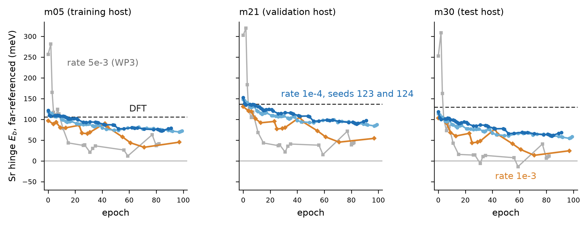

# WP3 re-tests V5 and V4 — the seed effect at learning rate 1e-4, and the order of the loss with the rate (2026-11-19)

Addendum to `WP3_RETESTS.md` (V1, V1b, V2, V3). Both arms are **post hoc and diagnostic only**; no model is adopted.
Every number below is copied by code from the json or csv file named beside it.

## 1. Summary

- **Pre-specification:** `V4V5_PRESPEC_2026-11-18.md` (sha256 `04ef00ef726020b1c02e735e6879ee067766936a78f7b228e8d44cf68dd0282c`), committed
  and pushed on 2026-11-18 at 11:10:58Z (commit `73eb26a`), before either run started (V5 at 11:11:26Z).
- **V5** (the V3 command with seed 124): P1 = 54.84 meV, P3 = 15.37 meV/Å. Its difference from V3,
  d = 7.80 meV, is within the 20 meV limit: by the rule, "V3's result is reproduced within the limit". By V3's own
  class rule V5 is "**lost**" (P1 > 50 meV) where V3 was "**partial**" (P1 = 47.04 meV): the two seeds lie on
  either side of the 50 meV line. The class at this rate is therefore not a stable property; the values are.
- **V4** (the WP3 command with learning rate 1e-3): P1 = 83.52 meV, P3 = 13.63 meV/Å; class "**lost**".
  P1(V4) − P1_low = +32.58 meV, above the limit of 20 meV: by the rule, "**ordered with the rate**".
- **What this is, in the rule's own words:** "a dose-response observation over three rates on one data set; it is not
  a demonstration that the rate is the cause, and replay (V2) remains untested at WP3-level forces."
- The readings of V1, V1b, V2 and V3 in `WP3_RETESTS.md` are unchanged. Its sentence that V3 is "partial" now has to
  be read with V5: at rate 1e-4 one seed is "partial" and one is "lost".

| Arm | learning rate | seed | P1 (meV) | P3 (meV/Å) | m30 Sr hinge (meV) | m30 Sr flank (meV) | m30 GA (meV) | m21 Sr (meV) | m21 GA (meV) | ΔE_a pairs (meV) |
|---|---|---|---|---|---|---|---|---|---|---|
| zero-shot | – | – | 9.20 | 86.81 | +123.0 | +109.6 | 43.49 | 32.06 | 23.90 | 23.65 |
| V3 | 1e-4 | 123 | 47.04 | 15.76 | +68.5 | +42.5 | 7.13 | 34.12 | 48.49 | 22.11 |
| V5 | 1e-4 | 124 | 54.84 | 15.37 | +58.4 | +33.4 | 7.53 | 39.83 | 46.74 | 20.98 |
| V4 | 1e-3 | 123 | 83.52 | 13.63 | +24.3 | -3.4 | 5.19 | 67.77 | 33.25 | 23.63 |
| WP3 | 5e-3 | 123 | 88.71 | 14.94 | +11.6 | -3.0 | 15.16 | 77.73 | 33.57 | 32.76 |

P1: error RMS of the far-referenced Sr E_b over the 3 non-far m30 Sr sites. P3: force RMSE over the 46 m30/m32 test
frames. DFT values of the m30 Sr hinge and flank: +129.4 and +95.6 meV. Sources: `v1_eval.json` (ZS, WP3),
`v3_eval.json`, `v4_eval.json`, `v5_eval.json`.

## 2. The rule applied (by code, to the json files)

- Classes by V3's rule ("kept": P1 ≤ 25 and P3 ≤ 45; "lost": P1 > 50 with P3 ≤ 45; "under-trained": P3 > 45; otherwise
  "partial"): V3 partial, V5 lost, V4 lost.
- Seed effect: d = |P1(V5) − P1(V3)| = |54.84 − 47.04| = 7.80 meV ≤ 20 meV. The first line of the V5
  reading applies: the statement "lowering the rate alone keeps the sign and about half of the hinge value" stands
  for two seeds, with both classes reported. The hinge values are +68.5 and +58.4 meV (0.53 and
  0.45 of the DFT value); the flank values are +42.5 and +33.4 meV (0.44 and 0.35).
- Order with the rate: P1_low = mean(47.04, 54.84) = 50.94 meV; limit max(20 meV, d) = 20 meV;
  P1(V4) − P1_low = +32.58 meV with P3(V4) = 13.63 ≤ 45: "ordered with the rate".
- Not in the rule, reported only: P1(V4) is 5.19 meV below P1(WP3) = 88.71 meV, a difference under
  the 20 meV limit; between the rates 1e-3 and 5e-3 the P1 values are not resolved from each other.

## 3. What was run

- **Commands.** `run_v5/train_command.txt`: the V3 command with `--seed 124` and `--name wp3v5`. `run_v4/train_command.txt`:
  the WP3 command with `--lr 0.001` and `--name wp3v4`. Both run logs give the Initial validation loss 0.33213836, the
  value of WP3 and of gate G-train, and "Learning rate: 0.0001" (V5) and "Learning rate: 0.001" (V4).
- **Runs** (`V1_LOG.md`). V5: 2026-11-18 11:11:26Z to 23:24:04Z, 100 epochs, selected epoch 99 (the last), 45 kept
  checkpoints, model sha256 `fdcad671f826bca80614b09dbf4c4f167fa3e7ab9eadc8e9b9c073168b69558f`. V4: 2026-11-18
  23:24:04Z to 2026-11-19 15:06:11Z, 100 epochs, selected epoch 97, 15 kept checkpoints, model sha256
  `4e599e5be66963ecc42da4b3c968bad6d67a633eb7b879716fb2d2547fa9842c`. The selection is mace-torch's (lowest m21
  validation loss).
- **Evaluation.** `python -B eval_v1.py --out v5_eval.json V5=run_v5/wp3v5.model`, and the same for V4.
- **Trajectories.** `traj_v5.py` and `traj_v4.py` are `traj_v3.py` with the run directory changed; their "selected" rows
  reproduce the json files.

## 4. Checkpoint trajectories of the Sr hinge E_b (reported, not read by a rule)

| Arm | host | kept checkpoints | epoch 0 (meV) | minimum (epoch) | last kept (epoch) | steps that go up | largest rise (meV) |
|---|---|---|---|---|---|---|---|
| V3 (1e-4, seed 123) | m30 | 42 | +118.3 | +59.8 (84) | +68.5 (91) | 16 of 41 | +4.5 |
| V5 (1e-4, seed 124) | m30 | 45 | +113.8 | +54.1 (97) | +58.4 (99) | 17 of 44 | +5.5 |
| V4 (1e-3) | m30 | 15 | +102.9 | +13.3 (71) | +24.3 (97) | 5 of 14 | +29.5 |
| V3 (1e-4, seed 123) | m05 | 42 | +121.7 | +71.9 (84) | +79.0 (91) | 13 of 41 | +4.3 |
| V5 (1e-4, seed 124) | m05 | 45 | +118.3 | +69.6 (97) | +72.2 (99) | 14 of 44 | +5.8 |
| V4 (1e-3) | m05 | 15 | +96.6 | +32.7 (71) | +45.0 (97) | 5 of 14 | +21.1 |

Sources: `v3_traj.csv`, `v5_traj.csv`, `v4_traj.csv`. m05 is the training host (label +105.7 meV on the raw F
basis); m30 is the test host (DFT +129.4 meV). Figure: `fig_wp3_rate_trajectories.png` (dark blue V3, light
blue V5, orange V4, grey WP3 from `eb_trajectory.csv`; dashed line the DFT value).

- No trajectory is monotonic. In V3 and V5 about four steps in ten between kept checkpoints go up, by at most
  5.5 meV on m30; the net fall over the run is 49.8 (V3) and 55.4 meV (V5).
- In both, the selected model lies above the run's own minimum (by 8.7 and 4.3 meV on m30).
- V4 kept 15 checkpoints only (a checkpoint is kept when the validation loss improves), so its path between them is
  not known; its largest rise between kept checkpoints is 29.5 meV on m30.
- On the training host the hinge value ends below its own label in all three arms.
- A correction: the analyst's log first called the V5 trajectory "the same slow decline as V3" from five sampled
  checkpoints. That was not a comparison and is withdrawn (`V1_LOG.md`, entry of 2026-11-19 14:35Z). Nothing here
  tests whether two trajectories are the same.

## 5. Limits and disclosures

- The used test set; P1 rests on 3 sites of one host; V4 has one seed, the rate 1e-4 has two, WP3 one.
- The three rates differ in the selected epoch (91, 99; 97; 82 for WP3) and in how many checkpoints were kept, both
  set by the m21 validation loss. The comparison is of selected models, as pre-specified, not of equal training time.
- The order with the rate does not say why the Sr repulsion is lost. At every rate the hinge value on the training
  host ends below its label, so the lower rate limits the loss and does not remove it.
- Replay (V2) is not addressed by these arms: it kept the repulsion with P3 = 49.95 meV/Å, above the 45 meV/Å line.
- The choice of these two arms was made after V1 to V3 were read. The literature context that suggested the rate
  1e-3 (a documented default for single-head fine-tuning) comes from the project's literature check and was not
  re-read by the analyst.

## 6. Files added with this addendum

`V4V5_PRESPEC_2026-11-18.md` (committed earlier), `v4_eval.json`, `v5_eval.json`, `v4_traj.csv`, `v4_traj.json`,
`v5_traj.csv`, `v5_traj.json`, `traj_v4.py`, `traj_v5.py`, `run_v4/` and `run_v5/` (`train_command.txt`, `logs/`),
`fig_wp3_rate_trajectories.png`, and the updated `V1_LOG.md`. Paths are replaced by placeholders as `README.md` says.
