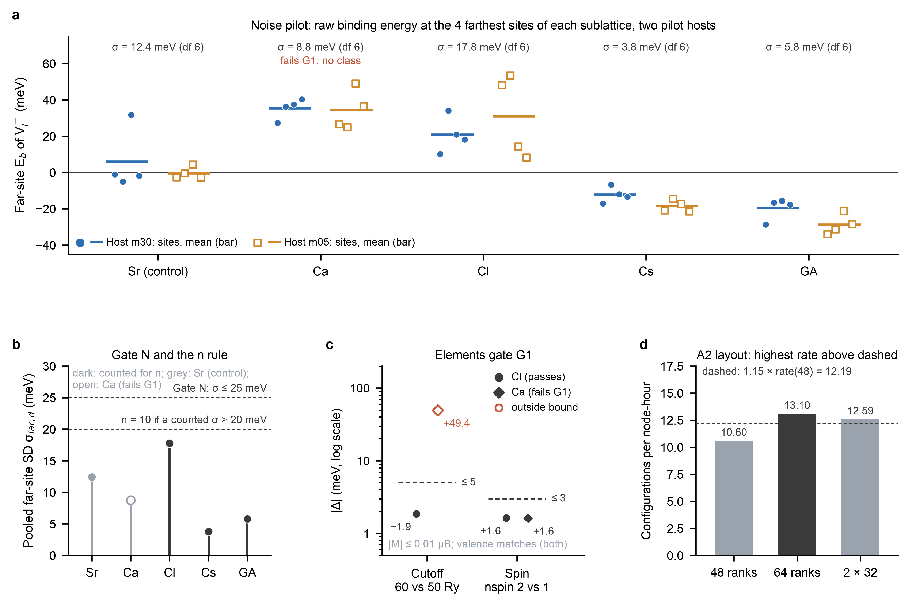

# S2 campaign 1 (C1): result note (2026-11-05)

C1 ran on 2026-11-04/05 at the campaign commit `8bff03e`. It is the first S2 campaign of `S2_PLAN.md` §17
item 5. This note records:
- what ran;
- the gate decisions the node took;
- what they change for C2-C4;
- the node items that only C1 could settle.

It reports the C1 pilot values as sections 7-9 of the plan define them. It computes no production
quantity and no A2 quantity (§6 names the one A2 start-set value that gate N reads).

**Archive.**
- Gate files, records, raw outputs, the campaign log: [`c1/`](c1/).
- Figure: [`figures/fig_s2_c1_gates.pdf`](figures/fig_s2_c1_gates.pdf) (caption below).
- Script and source data: [`figures/fig_s2_c1_gates.py`](figures/fig_s2_c1_gates.py),
  [`figures/source_data/`](figures/source_data/).

Labels: [R] read from a committed file; [N] a node observation kept in the private record folder, not
committed (`STAGE0.md` §8 item 9); [I] the analyst's inference or arithmetic. Times are UTC.

**Figure S2-C1 | C1 gate decisions (`S2_PLAN.md` §§7, 8, 16).**
- **a,** Raw far-site E_b of V_I⁺ (positive = repulsion) at the four farthest sites of each dopant's sublattice, on pilot hosts m30 (filled circles) and m05 (open squares). Bars give each host's mean over its four sites.
- **b,** Pooled far-site SD σ_far,d (df 6; a point estimate, on which the gates are pre-registered) against gate N (25 meV) and the n rule (20 meV). Only the decisive dopants that passed G1 count for n (dark). Sr (control, grey) and Ca (open; failed G1) do not count.
- **c,** Elements gate G1: |Δ_cut| (60/480 against 50/400 Ry) and |ΔF| (nspin 2 against 1) on a log axis, signed values printed, bounds dashed. Circles are Cl and diamonds Ca; open red marks a value outside its bound. |M| ≤ 0.01 μB and the valences match for both.
- **d,** Configurations per node-hour of the three layouts on the 232-atom reference cell (5 configurations each). The highest rate is chosen if it is at least 1.15 × rate(48) (dashed); 64 ranks (dark) was chosen.

Each E_b is one deterministic DFT result: there are no replicates and no error bars.

## 1. What ran

| item | value |
|---|---|
| commit (state.json `commit`; no `commit_history`) | `8bff03ede8b9d0f380b6ef373b239e7deb87817f` |
| launched | 2026-11-04 11:10:23 |
| interruption | spot termination notice at 11:14:28; the runner held new starts (N-11); the node stopped and was started again; relaunch with `s2_relaunch.sh` at 11:27:46 (second boot); no running job was cut (`interruptions.json` is empty) |
| ended (CAMPAIGN_DONE) | 2026-11-05 07:15:52 |
| phases (wall) | checks 10 s; smoke 54 min (includes the interruption); throughput row 100 min (its gate applied at 13:44:18); smoke at 64 ranks 15 min; MACE 3.53 h; single points 13.73 h; end-of-campaign gates (G1, N, n rule, pose) 22 s |
| jobs | 481 in the graph: 443 done, 36 skipped, 2 rejected (§3.4) |
| node-hours | H_spent 20.56 h at CAMPAIGN_DONE over the two boots (ledger complete, no problems); the plan's estimate was ≈ 29 h [R: `c1/ledger.json`, roadmap update 2026-11-03 (d)] |

The runner removed the keep-alive file at CAMPAIGN_DONE. The operator then set it again to guard the pull against the idle self-stop. The pull, the dry-run check, the removal of the keep-alive file and the stop of the node followed in the same boot, about two minutes after CAMPAIGN_DONE [N].

The runner's ledger counts that tail at the next S2 boot. It counts a past boot to the later of its last heartbeat + 60 s and its journal end (`scripts/50`, ledger).

Completeness by category [R: `c1/completeness.json`]:

| category | done | skipped |
|---|---|---|
| smoke tests (pw.x, 48 ranks) / at 64 ranks | 4 / 2 | |
| throughput row (48, 64, 2 × 32) | 4 | |
| MACE: hosts, V⁺_R, noise-pilot dopant cells, A2 start set, extra pose starts | 2, 30, 80, 20, 28 | 4 (extra pose starts) |
| single points: G1, spin, noise pilot, step-0 references, pose, q = 0 rows | 5, 2, 106, 2, 4, 10 | 32 (pose) |
| gates | 5 | |

## 2. Verification on the laptop

- **Pull.** A dry-run rsync after the pull listed no difference.
- **Pseudopotentials.** The 42 Cl and Ca pseudopotential headers printed in the outputs carry the MD5 of the C1 UPF record. None differs.
- **Archive.** `scripts/50_s2_campaign.py archive` returned 427 JSON files, 258 raw files (129 inputs and 129 outputs), 129 labels and 322 structures, with no hygiene refusal.
- **Gates.** `scripts/49_s2_gates.py verify --campaign c1` recomputed every gate from the archive: "5 gate files, 0 differ".

## 3. Gate decisions (the node's; S2_PLAN §§7-9)

### 3.1 Elements gate G1 (§7): Cl passes, Ca fails

The bounds are |Δ_cut| ≤ 5 meV and |F(nspin 2) − F(nspin 1)| ≤ 3 meV, with |M| < 0.1 μB.

| element | Δ_cut (60/480 − 50/400 Ry) | ΔF(nspin 2 − 1) | M_total / M_abs (μB) | valence | G1 |
|---|---|---|---|---|---|
| Cl | −1.9 meV | +1.6 meV | 0.00 / 0.01 | passes | **passes** |
| Ca | **+49.4 meV** | +1.6 meV | 0.00 / 0.01 | passes | **fails (cutoff)** |

Unrounded values: [`c1/gates/G1.json`](c1/gates/G1.json).

**Consequence (§7, §2 "Rule", §14 "Dopants without classes").**
- Ca leaves the decisive family. Its production and A2 cells are not run, and it receives no class at either tier. Its pilot values are reported.
- No setting is changed to rescue it. A later amendment may schedule Ca at a new fingerprint.
- The family quantile q* = 1 − 0.05/(2·4) is fixed in §14 and in `scripts/49` (RULES), and is not changed. For the three remaining decisive dopants this is conservative [I].

**What the failure does and does not show [I].**
- **What Δ_cut measures.** Δ_cut is the cutoff change of the substitution energy F(D) − F(host), at fixed geometry. The two cells differ in composition (one Pb replaced by Ca).
  - A far-referenced E_b is at fixed composition and cancels this error to first order (§7).
  - Whether Ca's far-referenced E_b moves by more than 5 meV between the two cutoffs was not measured.
  - The gate is the pre-registered convergence bound, and it was not met.
- **The sign.** On raising the cutoff, the Ca-doped cell's free energy fell by 1380.4 meV and the host's by 1429.7 meV [R: the G1 outputs in `c1/raw/`].
  - So replacing one Pb by Ca lowers the cell's cutoff dependence by 49 meV.
  - The gate cannot say whether the Pb file (S1 fingerprint) or the Ca file is the less converged in absolute terms. Nor can it say whether either is converged at 60/480 Ry.
  - A first reading that blamed the Ca semicore projectors is not supported by this sign [I].

### 3.2 Noise pilot and gate N (§8): all five dopants pass; Sr passes, so S2 continues

σ_far,d is the pooled SD of the raw far-site E_b about each host's mean. It uses 4 far sites per host, two pilot hosts (m30, m05) and df = 6 for every dopant.

| dopant | σ_far,d (meV) | host mean Ē_p: m30 / m05 (meV) | gate N (σ_far ≤ 25 meV) |
|---|---|---|---|
| Sr (control) | 12.4 | +5.9 / −0.4 | passes |
| Ca | 8.8 | +35.3 / +34.3 | passes (Ca has already failed G1) |
| Cl | 17.8 | +20.8 / +31.0 | passes |
| Cs | 3.8 | −12.3 / −18.6 | passes |
| GA | 5.8 | −19.7 / −28.7 | passes |

Every per-site value is in [`c1/gates/N.json`](c1/gates/N.json) and in figure panel a.
- The figure script re-derives each σ_far,d from the per-site values and asserts that it equals the gate's value.
- `sr_stop` is false, so the protocol continues to A2 (§8).

**Observations [I]; no decision rests on them.**
- **Site-independent offsets.** For Ca, Cl, Cs and GA the host means are clearly non-zero (−29 to +35 meV). Both hosts share one sign per dopant: positive for Ca and Cl, negative for Cs and GA. Such offsets are what far-referencing removes (§1).
- **Sr.** Sr's host means (+5.9 and −0.4 meV) are consistent with zero. The m30 mean is raised by one site (below); the other three m30 sites average −2.6 meV.
- **Precision of σ_far,d.** σ_far,d is a point estimate with 6 degrees of freedom, and its 95% χ² interval is wide: for Cl, 11.4-39.1 meV. Gate N and the n rule are pre-registered on the point estimate (§8).
- **Largest deviation.** The single largest deviation from a host mean is Sr at Pb148 on m30: +31.7 meV, which is 25.8 meV above the m30 mean.
- **Pb148 is a near-tie.** Pb148 is the fourth-farthest Pb site of m30, ahead of Pb112 by 0.0006 Å (§4, [R]). It is part of the pre-registered far set and stays in the statistic.
- **Zero-shot MACE values.** §8 also asks for the zero-shot MACE values of the same cells. They are not computed here. §17 confines the MACE ledger to the one evaluation, which will report them, labelled.

### 3.3 n rule (§8): n = 8

No member of the decisive family that passed gates N and G1 has 20 < σ_far,d ≤ 25 meV (the largest is Cl at 17.8 meV). So n = 8. Ca and Sr do not count for n.

### 3.4 Pose pilot (§9): default poses for Cs and Cl; a_pose = 0

**Cs and Cl.**
- At both pilot sites (Cs: FA128 and FA188; Cl: I138 and I175), every admissible start relaxed to a valid geometry: 7, 5, 3 and 3 starts per leg.
- Every one of them reached the default minimum. Against the default, the largest differences were 0.076 Å for a dopant atom (tolerance 0.25 Å), 0.015 Å for an FA carbon (0.25 Å) and 0.57° for an FA rotation (20°) [R: `c1/pairs/*.distinct.json`].
- So each leg kept one minimum (N_D = N_D+V = 1).
- Hence Δ_pose = 0 at both sites, the count term is 0, production uses the default pose and a_pose,d = 0.
- So 32 pose single points were not needed (skipped). The 4 default-pose single points at the near sites were run.

**Rejected starts.**
- Two shifted Cs starts at FA188 (poses q1+ and q2−) were inadmissible. The displaced start closed an A–X contact to 3.959 and 3.961 Å, below the 4.0 Å limit [R: `c1/pairs/m30_Cs188p3.json`, `m30_Cs188p6.json`].
- They were rejected by the builder before any relaxation: the 2 rejected jobs.
- Their 4 MACE relaxations (two per start, D and D+V) were skipped.

### 3.5 A2 layout (throughput gate, X-4): 64 ranks

| layout | configurations per node-hour (reference cell, 5 configurations) |
|---|---|
| 48 ranks | 10.60 |
| 64 ranks | **13.10**: the highest rate, 1.236 × rate(48) ≥ 1.15, so chosen |
| 2 × 32 ranks, concurrent on disjoint cores | 12.59: 1.188 × rate(48); pair valid, overlap 2789 s; lower than 64 |

The rule (§16, X-4): the layout with the highest rate is used if it beats 48 ranks by at least 15%.

The exit/restart smoke test was repeated at 64 ranks.
- p1 was stopped by the exit file after one configuration.
- p2 restarted and continued the counters with no repeated step. The three configurations make up nstep 3.
- c₀ = 0 and the affine slope 1 were fixed at 48 ranks (runs n1 and n3), so nstep_first = 201 [R: `c1/smoke.json`].
- At 64 ranks the exit/restart test confirmed that the counters continue with offset 0, so a restart runs 201 − completed − c₀ further configurations [R: `c1/smoke2.json`].

## 4. Node items settled by C1 (`STAGE0.md` §8 item 9)

- **Two-copy pinning (R4-C1-1).**
  - Before the launch, the committed launcher placed 32 ranks on cores 0-31 and 32 on cores 32-63 [N].
  - During the 2 × 32 row, three samples two minutes apart showed the same placement, with 32 pw.x processes per copy [N].
  - The throughput record holds cpuset = affinity (0-31, 32-63) for the two copies [R: `c1/throughput.json`].
- **Memory of two concurrent 232-atom copies (R4-C1-7; a node-only item, unverified before C1).**
  - Peak used memory was 97 of 247 GB (pw.x resident 95.4 GB) [N].
  - Both copies completed, and no rerun was recorded [R].
- **MACE phase.**
  - 160 relaxations ran, all at the first attempt [R: `c1/records/`, `c1/logs/campaign.log`].
  - At most 10 ran at once [R], with a 1-min load of 40-48 on 64 cores [N].
- **Spot handling.**
  - The termination notice held new starts as designed.
  - The relaunch resumed at the recorded commit, with the check records kept.

## 5. Consequences for C2

C2 runs **8 A2 relaxations** at 64 ranks. The Ca136 D and D+V relaxations of `C2_ORDER` are not run: G1 failed for Ca. The graph preview from `c1/state_end.json` gives 8 A2 relaxations, 8 validity checks, 5 gates and 2 checks (UPF, node scripts): 23 jobs, with the adjustment "Ca failed G1: Ca136 D, D+V not run". The host_R and V⁺_R relaxations of Pb136 still run, because they also serve Sr.

**No change of commit.**
- C2 runs at `8bff03e`, with no redeployment.
- The runner fixes one S2 commit across campaigns (`scripts/50` `check_commit`). It accepts a new HEAD only through `c2/STEP0_FIX` after a failed step-0 check.
- The suggestions recorded in `STAGE0.md` §7 (R5-3, R6-C1-3, R6-C24-1) are therefore not applied. D-S0-12 allowed them "if at all".
  - R5-3 and R6-C1-3 lie on fault paths that fail closed.
  - R6-C24-1 needs a deliberately committed symbolic link, which the repository does not hold. It affects only the reported D3(BJ) row (D-S0-4).

**What still governs C2.** The step-0 check, K2, the cost projection and K3 (§11) apply as pre-registered.

**Budget.** H_spent is 20.6 of the 520 node-h hard cap.

## 5a. Consequences for C3, C4 and the calibrated tier

**Graphs.** Read-only graph previews from `c1/state_end.json`:
- C3 drops 8 MACE relaxations and 8 single points per host (544 single points at n = 8).
- C4 drops the Ca124 D and D+V relaxations (24 relaxations).

**Degrees of freedom of the calibration [I].**
- Ca now has m_d = 0, so df_δ = Σ(m_d − 1) (§14) is at most 4 (Sr, Cl, Cs and GA), against 5 in the plan.
- §16 states that cuts 1-4 leave df_δ = 3. That assumed Ca. Under the unchanged cut order, cut 1 (GA on m05) now leaves df_δ = 3, and cut 2 (Cs on m05) leaves 2. C5 then fails, and no class can be validated.
- The cut order itself is unchanged: only an amendment could change it.
- Dropping Ca also lowers the projected node-hours P, so a cut is less likely than in the plan.
- The power figures of §18 assumed df_δ = 5 throughout.

## 6. Blinding (§17)

**What was read.** Gate decisions, counts, timings, and the pilot values that the C1 gates read and the plan reports (§§7-9).

**One A2 start-set value is known.** Gate N computed the A1 E_b of the m30 Sr far quartet at Pb76 (−5.0 meV). Those are the noise-pilot cells (§11). The value is plotted in panel a and is the A1 term of δ_far (§11). It is a permitted pilot read (§§8, 17).

**What was not read or computed.**
- No other E_b of an A2 start-set cell, and none of an A2-II (C4) cell.
- No q = 0 link row (§10; reported at the one evaluation).
- No MACE energy.
- No production value.

**What remains visible.** The raw energies are in the archived outputs. The blinding rests on not combining them.
