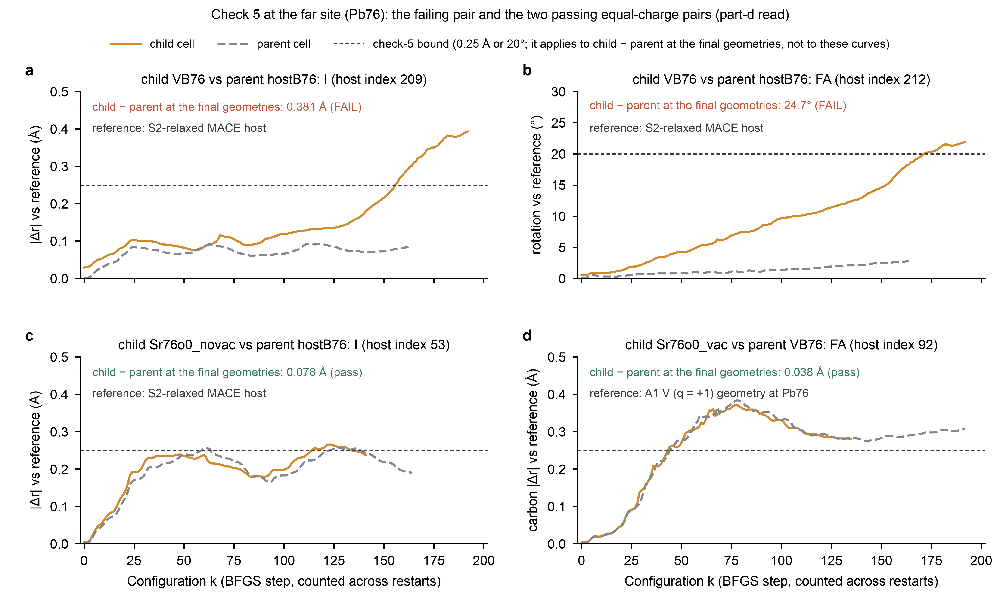

# S2 C2: geometry-only diagnostic of the check-5 failure (2026-11-11)

This note publishes the diagnostic of `S2_PLAN.md` amendment 2026-11-11a, part d: its tools, its one read, and the
reading that part d fixes. It concerns the section-11 check 5 that VB76 failed in C2 (`C2_RESULT.md` §2, §4). It reads
geometry only. K3 stands as recorded (fail_replan), and nothing here admits a cell or changes a decision.

**Tools and read.**
- `c2_diagnostic/check5_diag.py`, commit `966aa75`. It holds:
  - D5, an independent recomputation of check 5;
  - R46, a copy of `check_partner` that also returns its per-object lists;
  - G, a positions-only reader of raw A2 outputs.
- `c2_diagnostic/part_d_read.py`, commit `2b4657d`: the batch driver that prints items 1-5 of part d and nothing else.
- Both were committed with passing self-tests before the read. Part d fixes in advance what the read prints, and its
  `--read` refuses to run on uncommitted tools.
- **The read** ran once, at `2b4657d`, after the C2 archive had passed verify (`C2_RESULT.md` §3). It exited 0, and no
  tool raised.
- **Output, unedited:** [`c2_diagnostic/part_d_read_output.txt`](c2_diagnostic/part_d_read_output.txt).
- **Figure:** [`figures/fig_s2_c2_check5_diag.pdf`](figures/fig_s2_c2_check5_diag.pdf). Script and source data:
  `figures/fig_s2_c2_check5_diag.py` and `figures/source_data/fig_s2_c2_check5_diag.csv`. The figure plots item-5 lines
  of the output and annotates item-3 values. It reads no archive file.

**Labels.**
- [R]: read from the output file.
- [I]: the analyst's inference.
- Indices are 0-based; "host" indices number the 233-atom host.

**Figure S2-C2-D | Check 5 at the far site (Pb76).**
- **What each curve shows.** The displacement of one object from a common reference, at every configuration k of the
  child cell (solid) and of the parent cell (dashed).
- **The references.**
  - In **a-c**, the S2-relaxed MACE host.
  - In **d**, the A1 V (q = +1) geometry at Pb76, which is the reference of a D+V child.
- **What check 5 tests.** It tests the child − parent difference at the final geometries. That value is printed in each
  panel. The dashed bound applies to it, not to the curves.
- **The panels.**
  - **a, b:** the failing pair, VB76 against hostB76. **a**, I (host 209); **b**, the rotation of the C-N-N skeleton of
    FA (host 212).
  - **c:** Sr76o0_novac against hostB76, I (host 53), the gated inorganic atom of largest child − parent |Δr| in that
    pair.
  - **d:** Sr76o0_vac against VB76, FA (host 92), the gated FA of largest rotation in that pair; its carbon |Δr| is
    shown.
- **Uncertainty.** Each point is one geometry of one deterministic relaxation. There are no replicates and no intervals.

## 1. Integrity (item 1)

For all eight C2 records the driver found 11 of 11 integrity checks equal [R]:
- the record's file hashes;
- the geometry hashes of the validity record: start, final, parent final and relaxed host;
- the configuration count and last k against G;
- each final geometry against G's last configuration, within 10⁻⁶ Å;
- the cell.

The validity leaves repeat `C2_RESULT.md` §2: VB76 has valid False and failed [5]; the other seven have valid True.

## 2. Agreement (item 2)

| pair (child against parent) | record | D5 | R46 | D5, permutation-invariant reading |
|---|---|---|---|---|
| VB136 against hostB136 | pass | pass | pass | pass |
| Sr136o0_novac against hostB136 | pass | pass | pass | pass |
| Sr136o0_vac against VB136 | pass | pass | pass | pass |
| **VB76 against hostB76** | **fail** | **fail** | **fail** | **fail** |
| Sr76o0_novac against hostB76 | pass | pass | pass | pass |
| Sr76o0_vac against VB76 | pass | pass | pass | pass |

[R] The three implementations agree on every pair, so there is no disagreement to resolve and no code error is
indicated in `scripts/46` or in the tools. The permutation-invariant reading (part e, item 2) is reported only.

## 3. The failing pair (items 3 and 4)

- **Gated objects.** VB76 against hostB76 has 14: 7 inorganic and 7 FA, each more than 6.0 Å from the vacancy in the
  relaxed host [R].
- **The two that fail** [R]:

| object | distance from the vacancy (relaxed host) | child − parent at the final geometries | with the nitrogens exchanged |
|---|---|---|---|
| I, host 209 | 10.56 Å | \|Δr\| 0.381 Å | — |
| FA, host 212 | 7.85 Å (carbon) | carbon \|Δr\| 0.463 Å; rotation 24.7° | 177.1° |

- **The other twelve** stay at or below 0.183 Å and 13.0°.
- **Which cell moved** [R]. Each failing object is measured against the S2-relaxed MACE host:

| object | VB76 final | hostB76 final | VB76 against hostB76 at k = 0 |
|---|---|---|---|
| I, host 209 | 0.393 Å | 0.087 Å | 0.029 Å |
| FA, host 212 | 0.367 Å; 21.9° | 0.138 Å; 2.8° | 0.011 Å; 0.6° |

## 4. Trajectories (item 5)

[R; figure a, b]
- **VB76.** The displacement of both failing objects from the reference grows through the relaxation:
  - I 209 exceeds 0.25 Å from k = 156;
  - FA 212 exceeds 20° from k = 158;
  - the relaxation has 193 configurations (k = 0-192).
- **hostB76.** Over all 165 configurations, I 209 stays within 0.092 Å, and FA 212 within 0.14 Å (carbon) and 2.8°.
- **What these crossings are not.** They are measured against the reference, not between child and parent. The read
  does not print the child − parent difference at each k.

[R; figure c, d] In the two far pairs that pass, both cells move away from their common reference by similar amounts:
- I 53 by up to 0.27 Å;
- the carbon of FA 92 by up to 0.38 Å.
At the final geometries the child − parent values are only 0.078 Å and 0.038 Å.

## 5. Reading (as part d fixes it: described, not sorted into branches)

- **Kind of failing object.** The failing objects include an inorganic atom (I 209) and an FA (212).
- **Which cell left the common reference.** One cell did: the V⁺_R cell VB76 moved from the common reference, while
  its partner hostB76 stayed close to it. The two cells agreed at k = 0.
- **Nitrogen exchange.** It does not remove the failure: FA 212 turns by 24.7°, or 177.1° with the nitrogens exchanged.
- **Relaxations 7 and 8.** They do not show the pattern. Their pairs pass, with largest gated child − parent values of
  0.078 Å (Sr76o0_novac) and 0.067 Å (Sr76o0_vac) and rotations of at most 2.0°.
- **Charge.** The pattern differs between the charge-contrast pair and the equal-charge pairs:
  - VB76 against hostB76 (q = +1 against neutral) fails;
  - Sr76o0_novac against hostB76 (both neutral) passes;
  - Sr76o0_vac against VB76 (both q = +1) passes.

**Observations that bear on the design of S2b [I].**
- **The checks gate different regions.**
  - The check of a V⁺_R child is centred on the vacancy, so at the far site it gates the region around the Pb76 site,
    about 11.8 Å away.
  - The checks of D and D+V children are centred on the site, so they gate the region around the vacancy.
  - The two failing objects appear in neither site-centred table (item 3). They lie within 6 Å of the site, in the
    region that only the V⁺_R check gates.
- **The failure came late.** The failing displacement built up late in the longest C2 relaxation. During that stretch
  its force criterion stayed close to the threshold (`C2_RESULT.md`, figure a).
- **Whether the drift is reproducible is untested.** One relaxation cannot show it, for example from an independent
  start (part e, item 3). Nor can geometry alone show whether the drift reflects a physical response of the charged
  cell or a property of the optimiser on a flat surface.

## 6. Blinding

- **What was printed.** Geometry only. G asserted that no energy and no force was read, and the driver asserted that
  scripts/47 read no value other than positions.
- **What was not opened.** No gate file. No calculator was loaded.
- **What stays unread.** Every item of the part-c list of amendment 2026-11-11a: the K3 value, the quartet E_b^A2,
  δ_Sr,m30 and δ_far, every relaxation energy and F(k), E_b^A1(Pb136) and the plateau differences.
- **Status of these outputs.** They are part-d outputs. S2b must list them, and every choice made knowing them
  (part e, item 6).

## Erratum (2026-11-12)

**§4, the line "FA 212 exceeds 20° from k = 158".** The part-d output (`c2_diagnostic/part_d_read_output.txt`, item 5)
shows two separate crossings:
- the FA 212 carbon exceeds 0.25 Å from the reference from k = 158;
- its rotation exceeds 20° from k = 172.

Figure S2-C2-D panel b plots the rotation correctly. No other statement of this note changes. The error was found by a
reviewer of the S2b drafts.
