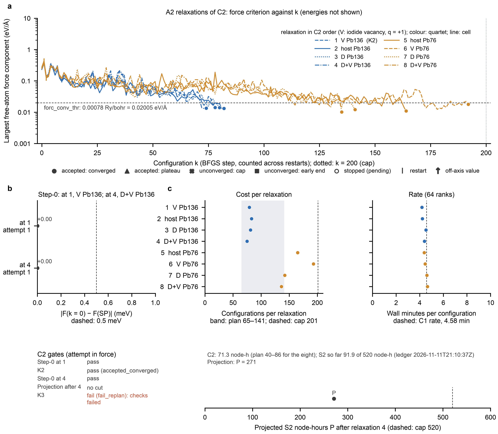

# S2 campaign 2 (C2): result note (2026-11-11)

C2 ran from 2026-11-07 to 2026-11-11 at the campaign commit `8bff03e`. It is the A2 calibration on the pilot host m30
(A2-I; `S2_PLAN.md` §11). This note reports what `C2_OPERATIONS.md` (OPS2, at `aeff9fd`) fixed in D-C2-10 to D-C2-12
before any C2 value existed. It also states the consequence that amendment 2026-11-11a of `S2_PLAN.md` (commit `1f8e496`,
written before the node took the K3 decision) attaches to that decision. It reads no energy, no relaxation energy, no
quartet E_b and no K3 value (section 8).

**Result.**
- All eight A2 relaxations completed with the end rule accepted_converged. None reached the cap of 201 configurations.
- Seven relaxations passed the section-11 final-geometry checks 2-5. VB76, the V⁺_R cell of the far quartet at Pb76,
  failed check 5 (the partner check against hostB76).
- **K3: fail (fail_replan)**, with `checks_failed` = ["s2r_m30_VB76: final geometry fails check(s) [5]"]. The value test
  was not reached.
- **Consequence** (§11; amendment 2026-11-11a, part b): A2 and production stop, and S2 is re-planned. C3 recorded
  not_run, and C4 is never started. Under the plan as it stands, S2 delivers no A1 tier and no validated class.
- **Cost:** C2 used 71.3 node-h (plan 40-86 node-h). S2 has used 91.9 of its 520 node-h.

**Archive.**
- Gate files, A2 records, validity records, raw A2 outputs, final structures and the campaign log: [`c2/`](c2/).
- Figure: [`figures/fig_s2_c2_a2.pdf`](figures/fig_s2_c2_a2.pdf) (caption below).
- Script and source data: [`figures/fig_s2_c2_a2.py`](figures/fig_s2_c2_a2.py) and
  [`figures/source_data/fig_s2_c2_*.csv`](figures/source_data/).
- Verification outputs, and the field comparator published unchanged (D-C2-10): [`c2_verify/`](c2_verify/).

**Labels.**
- [R]: read from a committed file.
- [N]: a node observation kept in the private record folder, not committed (`STAGE0.md` §8 item 9).
- [I]: the analyst's inference or arithmetic.
- Times are UTC.



**Figure S2-C2 | The eight A2 relaxations of C2 and the C2 gates (OPS2 D-C2-11, fixed before the data).**
- **a,** The largest Cartesian force component on the free atoms against configuration k, counted across restarts. There
  is one line per relaxation, in C2 order.
  - Colour shows the quartet: blue for the hinge (Pb136), orange for the far site (Pb76).
  - Line style shows the cell: host, V (iodide vacancy, q = +1), D (Sr) and D+V.
  - Energies are neither read nor shown.
  - pw.x ends a relaxation when the change in F between consecutive configurations is below 10⁻⁵ Ry and every free force
    component is below forc_conv_thr (dashed: 7.8 × 10⁻⁴ Ry/bohr = 0.02005 eV/Å). Only the second criterion is drawn, and
    pw.x's own flag, not the curve, decides the end rule.
  - Filled circles mark accepted_converged, which applies to all eight relaxations. Ticks mark restart parts
    (relaxation 7, at k = 1 and 2). The dotted line marks k = 200.
- **b,** Step-0 |F(k = 0) − F(SP)| of the two step-0 checks against 0.5 meV (dashed), and the state of the five C2 gates.
  K3 is shown by its state only.
- **c,** Configurations per relaxation against the planning band of 65-141 (shaded) and the cap of 201 (dashed). Wall
  minutes per configuration at 64 ranks against the C1 rate of 4.58 min (dashed). The projection P after relaxation 4
  against the 520 node-h cap.

Each point is one deterministic DFT result, or one pair of calculations for step-0. There are no replicates, so no
interval is drawn.

## 1. What ran

| item | value |
|---|---|
| commit (state `commit`; no `commit_history`) | `8bff03ede8b9d0f380b6ef373b239e7deb87817f` [N: D1 checks at every relaunch] |
| launched | 2026-11-07 01:06:35 [R: `c2/logs/campaign.log`] |
| ended (CAMPAIGN_DONE) | 2026-11-11 21:10:37, `end: {'done': 23}` [R] |
| jobs | 23 done: 2 checks, 8 A2 relaxations, 8 A2 validations and 5 gates [R: `c2/completeness.json`] |
| boots with C2 | 4, of 0.25, 49.68, 0.18 and 21.23 h [R: `c2/ledger.json`] |
| interruptions | 3 spot termination notices: 2026-11-07 01:12:26, 2026-11-09 02:56:25 and 2026-11-10 23:46:24. Each was followed by the reclaim of the instance and a relaunch after the pre-checks D1-D3 [R: log; N] |
| idle | The node was stopped from the reclaim of 2026-11-09 (about 03:04) to 2026-11-10 23:41. This costs no node-hours [N] |
| ranks | 64 for every part (the C1 throughput gate) [R] |

C3 was started once in the boot that ended C2, at 21:12:09. It recorded "c3 not run: K3 failed: A2 and production stop;
S2 is re-planned (section 11) (N-D11)" and started no job [N]. The pull, the dry-run check and the stop of the node
followed in that boot, so no manual ledger entry is needed (OPS2 runbook J8) [N].

## 2. The eight relaxations (attempt in force)

[R: `c2/raw/*.a2.json`, `*.validity_final.json`, through the guarded reader of D-C2-12;
`figures/source_data/fig_s2_c2_a_relaxations.csv`]

| # | relaxation | quartet | cell | status, end rule | n_config | converged at k | checks 2-5 | restarts | reruns from zero | interruptions | wall_h | min per config | free atoms |
|---|---|---|---|---|---|---|---|---|---|---|---|---|---|
| 1 | VB136 (K2) | hinge | V⁺_R | complete, accepted_converged | 79 | 78 | passed | 0 | 1 | 1 | 5.52 | 4.19 | 69 |
| 2 | hostB136 | hinge | host_R | complete, accepted_converged | 83 | 82 | passed | 0 | 0 | 0 | 5.85 | 4.23 | 70 |
| 3 | Sr136o0_novac | hinge | D | complete, accepted_converged | 81 | 80 | passed | 0 | 0 | 0 | 6.11 | 4.53 | 70 |
| 4 | Sr136o0_vac | hinge | D+V⁺ | complete, accepted_converged | 75 | 74 | passed | 0 | 0 | 0 | 5.50 | 4.40 | 69 |
| 5 | hostB76 | far | host_R | complete, accepted_converged | 165 | 164 | passed | 0 | 0 | 0 | 12.05 | 4.38 | 100 |
| 6 | VB76 | far | V⁺_R | complete, accepted_converged | 193 | 192 | **failed [5]** | 0 | 0 | 0 | 14.36 | 4.46 | 99 |
| 7 | Sr76o0_novac | far | D | complete, accepted_converged | 142 | 141 | passed | 2 | 0 | 2 | 10.89 | 4.60 | 100 |
| 8 | Sr76o0_vac | far | D+V⁺ | complete, accepted_converged | 136 | 135 | passed | 0 | 0 | 0 | 10.54 | 4.65 | 99 |

Labels carry the prefix `s2r_m30_`. All cells have 232 or 233 atoms, and the free atoms are those of the region
file (`c1/regions`).

- **Relaxation 1.** The first spot notice came about 6 min after its start. The part left no usable restart data, so the
  runner reran it from k = 0 in the next boot (01:22:13), under its restart rule (rerun 1 of 2) [R].
- **Relaxation 7.** It was interrupted at k = 0 (2026-11-09 02:56:46) and at k = 1 (2026-11-10 23:46:46). It continued
  from its restart data as part 2 (nstep 200) and part 3 (nstep 199) [R]. Its 142 configurations are counted across the
  three parts.
- **The partner check.** Check 5 compares each cell with its partner [R: `parent_label` of the validity records]:
  - V⁺_R and D are compared with host_R of their quartet;
  - D+V⁺ is compared with V⁺_R of its quartet.
  VB76 failed against hostB76. Sr76o0_vac passed against VB76.
- **What is not reported here.** Which gated object failed, and by how much, is not part of D-C2-10. The geometry-only
  diagnostic of amendment 2026-11-11a, part d, reports it.

## 3. Verification on the laptop

- **Pull.** A dry-run rsync after the pull listed no difference [N].
- **Archive.** `scripts/50_s2_campaign.py archive --campaign c2` returned 8 labels, 20 raw files (10 parts, an input and an
  output each) and 8 structures, with no hygiene refusal [N]. `scripts/46`-`50` are unchanged since `8bff03e`.
- **Gates.** `scripts/49_s2_gates.py verify --campaign c2` printed the result that the runbook predicted from the code
  [R: `c2_verify/verify_c2.txt`]:
  ```
  OK   c2 K2
  OK   c2 K3
  DIFF c2 projection
  DIFF c2 step0
  verify c2: 4 gate files, 2 differ
  ```
- **Field comparator** (D-C2-6, D-C2-10; `c2_verify/verify_fields.py`, sha256 `e27d1126…49e4` as recorded in OPS2)
  [R: `c2_verify/verify_fields_c2.txt`]:
  - K2 and K3, in `gates/` and `gates_applied/`: decision, result and inputs digest are all equal.
  - step-0, all three files: decision and result are equal. Only the inputs digest differs. The opened files have the same
    content hashes; they differ only in path, node paths against archive paths.
  - Projection, both files: the decision is equal. The result differs at `/P_initial_h`, `/a2_completed` (4 against 8
    records) and `/work_after/N_relax`. The digest differs through the A2 records that only the archive holds.
  - Both differences are the two that D-C2-6 accepts. The node's decisions are in force.
- **C3.** The not_run C3 was archived privately, in a directory without C1 or C2 copies (amendment 2026-11-11a, part b,
  point 2). Its verify printed "0 gate files" and exited 1, as expected for a not_run C3 (OPS3 O19) [N].

## 4. Gates (the node's decisions)

[R: `c2/gates_applied/*.json` decisions; result leaf fields by name, through the guarded reader]

| gate | state | detail |
|---|---|---|
| step-0 at 1 (VB136) | pass | \|F(k = 0) − F(SP)\| = 0.0 meV against 0.5 meV |
| K2 | pass (accepted_converged) | relaxation 1 |
| step-0 at 4 (Sr136o0_vac) | pass | \|F(k = 0) − F(SP)\| = 0.0 meV against 0.5 meV |
| projection after 4 | no cut | `P_initial_h` 271.1 node-h (cap 520); `c4_run` true; n = 8 |
| K3 | **fail (fail_replan)** | `checks_failed`: s2r_m30_VB76: final geometry fails check(s) [5]; `end_rule_failed`: none |

- **Step-0.** Both values are exactly 0.0. `dF_meV` is the difference of the two parsed free energies (`scripts/47`,
  `step0_equivalence`). The k = 0 configuration therefore reproduced the C1 single point at the printed precision [I].
- **K3.** `k3_eval` adds every cell whose final geometry fails a check to `checks_failed`. If that list is not empty, it
  sets fail_replan before the value test and leaves `value_meV` null, although it still stores both quartet E_b^A2
  values [`scripts/49`:603-623 at `8bff03e`]. The value test (> +25.7 meV) was therefore not reached. This is stated from
  the code; the field was not opened.
- **A1 validity** (reported only; I-10, I-11):
  - K2: `a1_valid_reported` true.
  - K3: `a1_invalid_reported` empty, so all eight start cells were A1-valid.

## 5. Projection

- `P_initial_h` = 271.1 node-h against the 520 node-h cap. No cut applied, and `c4_run` was true [R].
- With Ca removed and no cut, the largest df_δ still attainable was 4 (`C1_RESULT.md` §5a).
- K3 fail_replan supersedes both: C4 does not run under this plan.

## 6. Cost

| quantity | measured | planning reference (D-C2-10) |
|---|---|---|
| configurations per relaxation | hinge 75-83; far 136-193 | 65-141 (median about 89); cap 201 |
| wall minutes per configuration (64 ranks) | 4.19-4.65 | 4.58 (C1 rate) |
| wall_h per relaxation | hinge 5.50-6.11; far 10.54-14.36 | 4.96-10.76 |
| C2 node-hours (4 c2-tagged boots; no manual rows; ledger complete, no problems) | 71.33 | 40-86 for the eight |
| node-hours outside every `wall_h` | 0.52 | |
| S2 `H_spent_h` at 2026-11-11 21:10:37 | 91.92 | cap 520 |

[R: `figures/source_data/fig_s2_c2_c_cost.csv`, `fig_s2_c2_a_relaxations.csv`; I: arithmetic]

- **Uncovered node-hours.** The 0.52 node-h outside every `wall_h` are the rerun first part of relaxation 1, the tails of
  the boots after each spot notice, and the gaps between parts [I].
- **The planning range.** It held for the hinge quartet. It under-predicted the far quartet:
  - three far relaxations exceeded 141 configurations;
  - three exceeded the per-relaxation range of 10.76 h.
- **Why the total stayed inside the plan.** The far cells relax 99-100 free atoms, against 69-70 at the hinge. The C2
  total stayed within 40-86 node-h because the hinge relaxations sat near the lower end of the range [I].
- **For S2b.** These are the measured costs on which any re-planned A2 should be projected (amendment 2026-11-11a,
  part e) [I].

## 7. Consequence: §11 and amendment 2026-11-11a

- **Whether the amendment applies.** Its Effect clause applies when the node records fail_replan with a non-empty
  `checks_failed` whose every entry names a far-quartet cell. Here the only entry names VB76, so the amendment applies.
- **What stops.** A2 and production stop, and S2 is re-planned (§11). C3 recorded not_run and C4 is never started.
- **Where the not_run C3 is held.** It is archived privately, kept out of this repository and out of any directory that
  holds c1, c2 and c3 together, until S2b.
- **The one evaluation is deferred.** No entry point of `scripts/48` is run on any S2 archive until S2b fixes how and
  when (amendment, part b, point 2).
- **What follows, in the amendment's order (part g):**
  1. a dated notice appended to `C3_OPERATIONS.md` and `D3BJ_AMENDMENT.md`;
  2. the geometry-only diagnostic of the check-5 failure (part d). Its tools D5, R46 and G were committed with passing
     self-tests at `966aa75`, before any C2 geometry was read. A batch driver is committed before the read;
  3. a public diagnostic note;
  4. the new pre-registration S2b (part e).

## 8. Blinding (§17; OPS2 D-C2-10)

**What was read.**
- Counts, timings and gate decisions. During C2 this included the H4 log line of the VB76 check failure, read before
  the amendment was written. Amendment 2026-11-11a, part a, records it.
- After the verify passed:
  - the leaf fields that D-C2-10 names, read by name through the guarded reader: `checks_failed`, `end_rule_failed`,
    `a1_valid_reported`, `a1_invalid_reported` and the step-0 `dF_meV`;
  - the validity leaves `valid`, `failed` and `parent_label`;
  - the force maxima of panel a, through the force-only reader. That reader asserts that `scripts/47` read no energy.

**What was not read.**
- The K3 value and both quartet E_b^A2.
- δ_Sr,m30 and δ_far.
- Every relaxation energy and every single F(k) of C2.
- E_b^A1(Pb136).
- Any plateau difference.
- The per-object check-5 quantities in the validity records. Part d reads them, after its tools are committed.

**Where the withheld values are held.**
- `c2/gates/K3.json` and `c2/gates_applied/gate_K3.gate.json` (`result.Eb_A2_meV`; `value_meV` is null by the code).
- The A2 records (`end_rule`).
- The raw outputs `c2/raw/*.out.gz`, which hold the raw energies.

The archive is public by design (D-C2-7). The blinding rests on not opening these fields and not combining the raw
energies. They stay unread until a rule of S2b, committed before, says otherwise (amendment 2026-11-11a, part c).

## 9. Figure QA

- **Build asserts** (D-C2-11) all passed:
  - `scripts/47` read no energy and no ASE value;
  - the k values of each line are 0 … n_config − 1 of its record;
  - the number of free atoms equals `n_free` of the start source;
  - at `converged_at_k` the largest free-atom component is ≤ 7.8 × 10⁻⁴ Ry/bohr;
  - every plotted gate state is re-derived from the files.
- **Panel alignment:** PASS (`figures/fig_s2_c2_a2.alignment.json`).
- **PDF text:** at least 6 pt everywhere (minimum 5 pt).
- **Collision audit:** 0 fail, 0 warn (`figures/fig_s2_c2_a2.collision-audit.json`).
- **Static preflight:** 21 pass.
