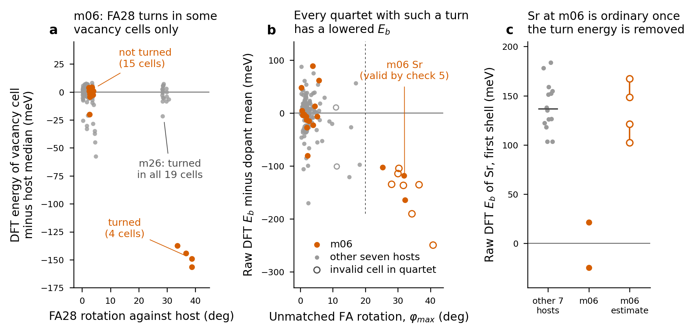

> Record of a post hoc diagnosis made on 2026-11-26 by a sub-task of the project lead, after E. The text is the
> sub-task's, unedited except that links to working files are replaced by file names. Its scripts and supporting
> tables are kept with the private c3b archive; the quartet table and the figure are beside this file.

# M06_DIAGNOSIS: why host m06 is an outlier for Sr at the fixed-geometry tier (post hoc)

Date: 2026-11-26. Post hoc diagnosis after the one-shot evaluation E; nothing here changes E. Data: all 8 hosts, all 544 cells and all 192 quartets of the private c3b archive `c3b_private_root_2026-11-23`; no subsampling. Repository read at commit 141490b (branch `feat/dopant-shell-dft-validation`) for definitions only.

## Verdict

1. **m06 is an ordinary host with one unfinished relaxation in its vacancy cells.** FA28 donates an N–H···I hydrogen bond to the vacancy iodide I127 (2.87 Å). Once I127 is removed FA28 turns by 34° to 39° (carbon shift 0.47 to 0.51 Å) down a slope so gentle that the FIRE stop criterion (largest atomic force below 0.01 eV/Å) is met before the turn: 15 of the 19 vacancy cells of m06 stopped unturned after 119 to 210 steps, 4 finished the turn after 1217 to 1395 steps, and 10 of the 19 D+V cells that start from an unturned vacancy cell finished it during their own relaxation.
2. **Both Sr first-shell quartets of m06 pair a turned D+V cell with an unturned V cell, so their E_b contains the energy of the turn**: −127 to −146 meV in DFT (−62 to −63 meV in MACE). This is the same defect as in the seven invalid m06 cells; the Sr cells pass check 5 only because FA28 lies 5.70 Å and 5.34 Å from Pb124 and Pb136, inside the 6 Å radius within which check 5 reports and does not gate. With the turn energy removed (an estimate, not a measurement) Y_h(Sr, m06) is 127 to 146 meV, inside the 114 to 166 meV of the other seven hosts.
3. **The same mechanism does not explain the site-to-site scatter of Cl or Cs.** No quartet outside m06 has an unmatched FA turn of 20° or more; four valid Cl values carry one of 15° to 18°. The Cl scatter goes mainly with the off-centre position of the Cl atom itself, the Cs scatter with the unrelaxed (start-geometry) part of E_b. Whether those are physical site differences or further unmatched minima is not settled by the present data.

*Figure. (a) The 19 vacancy cells of each host (one per region): DFT energy relative to the host's median against the rotation of FA28 relative to the relaxed host; m06 in vermilion, the other seven hosts in grey. (b) All 192 quartets: raw DFT E_b minus the mean of its dopant and shell (means over the valid quartets with φ_max < 10°) against φ_max, the largest FA rotation of D+V relative to V that is not matched in D relative to host; open symbols are the nine quartets with an invalid cell; the dashed line marks 20°, the bound of check 5. (c) Raw DFT E_b of Sr on the two first-shell Pb sites: the other seven hosts (n = 14, bar = median), m06 as evaluated, and m06 with the turn energy removed by two estimates (−127.2 and −145.9 meV; bars join the two estimates of one site). The values in (c), right, are estimates.*

## Deviations, departures and how to read this note

- **Data scope: no reduction.** 544 cells, 536 non-host cells, 192 quartets, 8 hosts.
- **No step was held by the platform.**
- **MACE environment.** The conda environment `mace316` existed but held no `mace`. I installed `mace-torch==0.3.16` into it with pip (torch 2.14.1, e3nn 0.4.4, numpy 2.5.4, ase 3.29.0, the versions of the records apart from the CPU build of torch). The foundation file was read from the project folder (`private/wp3_v1/foundation/20231203mace128L1_epoch199model`); its sha256 is 01bfe221…5845 as required. The local set-up reproduces `relax.E_mace_eV` of all 544 records (largest difference 2.9e-10 eV; `d04_mace_sp.py`).
- **MACE single points were used more widely than the start geometries alone.** Besides the 536 start geometries (needed for section D), 384 single points were run on constructed geometries (the "basin test" of section C) and 110 on interpolated paths. All are single points with zero-shot MACE-MP-0; no relaxation and no DFT was run.
- **`pandas` was added to `c3bdev`.** One light analysis script (`d02_quartets.py`) ran while a pip installation was still in progress; every MACE run was the only process.
- **A correction of the brief.** The two Sr first-shell quartets do not share one vacancy cell. Each site j has its own vacancy cell V_Rj (the same vacancy, relaxed in the region of that site): `s2_m06_VB124` and `s2_m06_VB136`. Cs and GA at one A site do share a vacancy cell.
- **e_h(j) is E's value wherever E formed it** (column `e_h_E_meV`). For quartets where E formed none I give my own value from all cells, labelled as such (`e_h_dft_all_cells_meV`); it is used only where stated.
- **Still-blinded material was not opened.** The repository was checked out sparsely without `c2/`, `c1/records`, `c1/raw`, `c1/gates*`, `fr/` and without any file named `*B136*` or `*Sr136*`. Inside the c3b archive the B136 and Sr136 files were read, as the brief allows.
- British spelling; energies in meV unless stated; "V" is the vacancy cell (relaxed neutral with MACE, +1 in DFT), "D" the doped cell, "D+V" both.

## A. The eight relaxed hosts: is m06 unusual as a host?

Script `d05_hosts.py`; tables `out/hosts.csv` (75 descriptors per host), `out/hosts_fa.csv` (every FA of every host), `out/hosts_report.txt`.

| host | host FIRE steps | MACE relaxation energy (meV) | Pb–I mean (Å) | Pb–I–Pb mean (°) | C(FA28)–I127 (Å) | shortest N–H(FA28)···I127 (Å) | I127 nearest iodide of an N–H of FA28 | of FA92 | of FA128 | V cells: FA28 rotation (°) | V steps |
|---|---|---|---|---|---|---|---|---|---|---|---|
| m06 | 2928 | -587 | 3.277 | 169.1 | 4.28 | 2.87 | yes | yes | no | 2.3 to 38.8 | 119 to 1395 |
| m02 | 2446 | -562 | 3.282 | 167.6 | 5.54 | 5.19 | no | no | no | 0.2 to 0.4 | 85 to 121 |
| m16 | 2839 | -439 | 3.272 | 170.1 | 5.02 | 3.24 | no | no | no | 0.9 to 1.0 | 83 to 115 |
| m12 | 4115 | -333 | 3.275 | 169.5 | 4.97 | 3.34 | no | no | no | 1.3 to 1.7 | 88 to 126 |
| m32 | 2478 | -501 | 3.275 | 169.8 | 4.34 | 4.04 | no | no | no | 1.9 to 4.8 | 83 to 546 |
| m26 | 3961 | -357 | 3.276 | 168.7 | 4.61 | 2.79 | yes | no | yes | 28.3 to 30.6 | 822 to 902 |
| m22 | 4272 | -710 | 3.280 | 167.9 | 4.47 | 3.96 | no | no | no | 2.2 to 2.4 | 128 to 154 |
| m23 | 4406 | -539 | 3.279 | 168.4 | 5.00 | 3.26 | no | no | no | 3.5 to 4.1 | 211 to 241 |

- **Lattice.** The eight hosts share one fixed cell (a, b, c = 19.435, 19.646, 19.753 Å; α, β, γ = 62.99°, 116.62°, 83.70°; 5523.5 ų); no difference.
- **Relaxation.** m06: 2928 FIRE steps (others 2446 to 4406), MACE relaxation energy −587 meV (others −710 to −333), final force 0.0050 eV/Å like every host. Its MACE energy is the second highest of the eight (−1066.479 eV; others −1066.537 ± 0.080) and its DFT energy the highest (z = 1.98 against the other seven); neither is extreme for n = 8.
- **Inorganic frame.** Pb–I mean 3.277 Å (others 3.277 ± 0.003), Pb–I–Pb mean 169.1° (168.9 ± 1.0), Pb–I–Pb at I127 165.2° (167.2 ± 5.1); Pb–I distances at Pb124, Pb136, Pb76 and Pb172 all within |z| ≤ 1.7. Nothing stands out.
- **What stands out is local to the vacancy.** In m06 the vacancy iodide I127 is the nearest iodide of an N–H of FA28 (2.87 Å) and of FA92 (3.16 Å); C(FA28)–I127 is 4.28 Å, the shortest of the eight hosts. The only other host in which I127 is the nearest iodide of an N–H is m26 (FA28, 2.79 Å, and FA128, 2.85 Å).
- **Consequence in the vacancy cells.** These are the molecules that turn when I127 is removed. m26: FA28 and FA128 turn by 28.3° to 30.6° and 27.9° to 29.1° in all 19 vacancy cells (822 to 902 steps). m06: FA28 turns by 33.6° to 38.8° in 4 vacancy cells and by 2.3° to 4.0° in the other 15; FA92, whose contact is longer, turns by 2.2° to 6.6°. In the six hosts without such a contact FA28 turns by at most 4.8°.
- **Reading.** m06 is not unusual as a host in any global descriptor. It is one of two hosts whose vacancy removes a hydrogen-bond acceptor, and the only one in which the resulting reorientation is finished in some cells and not in others. With 75 descriptors and n = 8, several |z| near 2 are expected by chance; the hydrogen-bond contact is singled out because it predicts which molecules turn (3 of the 4 flagged molecules turn by more than 27°, no unflagged molecule does), not because of its z.
- FA orientation vectors (N···N axis and N-midpoint→C) are tabulated per molecule in `out/hosts_fa.csv`; no orientational order parameter was formed (see "Not done").

## B. Displacement fields and quartet mismatch measures

Scripts `d01_cells.py` (536 cells), `d02_quartets.py` (192 quartets); tables `out/cells.csv`, `out/fa_rows.csv` (2706 cell × free-FA rows), `out/inorg_rows.csv` (11 578 cell × free-inorganic-atom rows), `out/quartets_geom.csv`.

**Check 5 recomputed from the structures.** My implementation reproduces the record leaves of all 536 non-host cells: 3048 quantities, largest differences 1.7e-16 Å (inorganic), 1.1e-16 Å (FA carbon), 8.4e-11° (FA rotation); no pass flag differs; the same nine cells fail. Fixed atoms do not move (0.0 Å). Away from the dopant, a cell's start geometry equals its parent's relaxed geometry (0.0 Å), so "relative to start" and "relative to parent" coincide for every atom except the dopant; displacements relative to the relaxed host are tabulated separately.

**Over all cells.** FIRE steps: median 116 (D), 138.5 (D+V), 128.5 (V); maxima 1476, 2097, 1395. 58 of the 2706 FA rows exceed a check-5 bound (carbon ≥ 0.25 Å or rotation ≥ 20°); only 8 of them are gated (the seven m06 cells and `s2_m22_GA16p0_novac`); the other 50 lie within 6 Å of the defect of that step, where check 5 reports only: 38 are FA28 and FA128 in the 19 vacancy cells of m26, 4 are FA28 in vacancy cells of m06, 4 are in D+V cells of m06 (FA28 in Sr124, Sr136, Cl102; FA200 in one cell), 4 are in m12 (2), m16 and m23. Among inorganic atoms 559 of 11 578 rows exceed 0.25 Å, 2 of them gated (I102 in `s2_m06_Cl138p0_vac`, 0.298 Å; I53 in `s2_m26_Cl137p0_vac`, 0.292 Å, the cause of that cell's failure).

**Mismatch measures of a quartet** (definitions in `d02_quartets.py`). E_b is a double difference of energies, so I use the double difference of the displacement fields over the atoms free in the region and present in all four cells: dd_i = [x_i(D+V) − x_i(V)] − [x_i(D) − x_i(host)], and for each FA molecule φ = the rotation angle of R(V→D+V)·R(host→D)⁻¹ of its C–N–N skeleton (Kabsch, invariant under exchange of the nitrogens). An additive lattice response gives dd = 0 and φ = 0. Per quartet: φ_max, the molecule that carries it and its distances from the site and from the vacancy, its rotation in each leg, the largest carbon and inorganic dd, the RMS of dd, and the class (unmatched FA turn ≥ 20°, 10° to 20°, none; carried by D+V or by D). Two energy measures from MACE single points are added in section C.

**Result: the unmatched turn is a property of m06.**
- φ_max ≥ 20° in 10 of 192 quartets, all at m06, all carried by FA28 in the D+V leg, all 4.28 Å from the vacancy: Sr B124, Sr B136, Cl X102, X137, X138, X175, Cs A92, A164, GA A92, A200. Seven of them are the invalid m06 cells; three are valid by check 5 (Sr B124, Sr B136, Cl X102).
- φ_max between 10° and 20° in 6 quartets: Cl X102 at m16 and m12, Cl X90 at m23 and Cl X137 at m26 (FA28 or FA128 in D+V), and Cl X125 at m02 and GA A16 at m22 (in D). Median φ_max per host 0.9° to 2.3° (m06 4.8°).

**The m06 cells, site by site** (FA28 state; `out/fa_rows.csv`, `out/vcells.csv`, `m06_quartet_table.csv`):

| site | FA28 to site (Å) | V: FA28 rotation (°), steps | dopant | D+V: FA28 rotation against V (°), steps | check 5 of D+V | raw E_b DFT (meV) | MACE E_b (meV) |
|---|---|---|---|---|---|---|---|
| B124 (first) | 5.70 | 3.5, 183 | Sr | 32.5, 990 | pass (FA28 reported only) | -24.8 | 92.1 |
| B136 (first) | 5.34 | 3.8, 210 | Sr | 31.8, 1076 | pass (FA28 reported only) | 21.3 | 87.0 |
| B76 (far f1) | 10.81 | 2.8, 160 | Sr | 0.6, 29 | pass (FA28 gated) | 3.0 | 5.6 |
| B172 (far f2) | 10.51 | 2.8, 160 | Sr | 0.8, 53 | pass (FA28 gated) | -5.7 | 1.9 |
| X49 (first) | 5.54 | 36.7, 1395 | Cl | 2.6, 138 | pass (FA28 reported only) | -45.8 | -3.9 |
| X53 (first) | 4.74 | 33.6, 1217 | Cl | 6.0, 223 | pass (FA28 reported only) | 96.9 | 26.7 |
| X90 (first) | 4.23 | 38.8, 1349 | Cl | 2.6, 157 | pass (FA28 reported only) | 124.0 | 31.2 |
| X102 (first) | 4.07 | 4.0, 199 | Cl | 25.9, 812 | pass (FA28 reported only) | -67.8 | -65.6 |
| X125 (first) | 7.96 | 3.4, 184 | Cl | 2.4, 215 | pass (FA28 gated) | 20.0 | -17.6 |
| X126 (first) | 8.10 | 3.4, 184 | Cl | 3.4, 295 | pass (FA28 gated) | 47.9 | 11.0 |
| X137 (first) | 7.41 | 3.4, 182 | Cl | 30.7, 1093 | **fail** (FA28 gated) | -69.5 | -53.1 |
| X138 (first) | 7.89 | 3.7, 194 | Cl | 28.7, 1040 | **fail** (FA28 gated) | -99.6 | -81.8 |
| X175 (far f1) | 10.96 | 3.1, 173 | Cl | 32.2, 1182 | **fail** (FA28 gated) | -107.7 | -72.9 |
| X222 (far f2) | 10.23 | 3.1, 173 | Cl | 1.3, 87 | pass (FA28 gated) | 26.4 | 0.4 |
| A28 (first) | 0.00 | 38.7, 1326 | Cs | FA28 replaced, 253 | pass (FA28 n/a) | 11.8 | 25.1 |
| A28 (first) | 0.00 | 38.7, 1326 | GA | FA28 replaced, 318 | pass (FA28 n/a) | -58.8 | -35.0 |
| A92 (first) | 6.06 | 2.5, 136 | Cs | 35.1, 1060 | **fail** (FA28 gated) | -226.8 | -57.6 |
| A92 (first) | 6.06 | 2.5, 136 | GA | 40.7, 2097 | **fail** (FA28 gated) | -295.3 | -184.7 |
| A128 (first) | 9.19 | 2.7, 138 | Cs | 1.8, 116 | pass (FA28 gated) | -63.9 | 33.9 |
| A128 (first) | 9.19 | 2.7, 138 | GA | 4.2, 290 | pass (FA28 gated) | -68.3 | -21.8 |
| A200 (far f1) | 8.65 | 2.7, 156 | Cs | 2.0, 126 | pass (FA28 gated) | -23.0 | -1.3 |
| A200 (far f1) | 8.65 | 2.7, 156 | GA | 31.6, 1104 | **fail** (FA28 gated) | -142.2 | -62.6 |
| A164 (far f2) | 9.19 | 2.3, 119 | Cs | 37.4, 1059 | **fail** (FA28 gated) | -152.0 | -56.2 |
| A164 (far f2) | 9.19 | 2.3, 119 | GA | 4.9, 416 | pass (FA28 gated) | -34.5 | -9.5 |

- **What moved in the ten D+V cells with the turn.** FA28 as a whole: rotation 25.9° to 40.7°, carbon 0.39 to 0.59 Å, its hydrogens by up to 1.10 to 1.43 Å (H35 is the most displaced atom of the Sr124 and Sr136 cells, 1.20 and 1.19 Å). The largest inorganic displacement of these cells is 0.24 to 0.38 Å and sits next to the dopant in every case (I126 at Sr124, I53 at Sr136, a Pb bonded to Cl, an iodide beside the Cs or GA site); at the two Sr cells it exceeds what Sr does in the other hosts (section D iii), elsewhere I did not separate it from the ordinary response to the dopant. A second molecule turns by more than 10° in three of the cells (FA92 17.9° at Cl138, FA176 13.9° at Cl175, FA212 10.6° at Sr124).
- **The seven invalid m06 cells and the three valid ones differ only in the distance of FA28 from the site.** Invalid: FA28 6.06 to 10.96 Å from the site, hence gated. Valid: 5.70 Å (Sr124), 5.34 Å (Sr136), 4.07 Å (Cl102), hence reported only. The recorded within-6 Å values of the two Sr cells are 32.55° and 31.80° (carbon 0.513 and 0.483 Å) against 0.6° to 5.3° (0.014 to 0.085 Å) for the Sr D+V cells of the other seven hosts.
- **Which D+V cells finish the turn is not decided by the dopant.** Of the 19 D+V cells that start from an unturned vacancy cell, 10 finish (812 to 2097 steps) and 9 do not (29 to 416 steps; FA28 0.6° to 4.9° against V). Cs164 finishes and GA164 does not; GA200 finishes and Cs200 does not; Cl175, 10.96 Å from FA28, finishes. The four vacancy cells that finished are those whose site is nearest FA28 (0 to 5.54 Å), yet X102 (4.07 Å), B136 and B124 did not.
- **The other two invalid cells are different cases.** `s2_m26_Cl137p0_vac` fails on one iodide (I53, 0.292 Å, 6.54 Å from the site). `s2_m22_GA16p0_novac` fails on FA28 in a D cell (16.9°, carbon 0.325 Å, 9.04 Å from the site): a host-side analogue, in which a doped cell without a vacancy moves a molecule the host keeps.
- **A sub-threshold analogue.** The vacancy cells of m32 take 83 to 546 steps (median 103) and one of them has an FA rotation of 11.9°; its quartets nevertheless have φ_max ≤ 7.5°, because the D+V cells inherit the vacancy cell's state.

## C. Is E_b contaminated when the cells of a quartet relax into different local FA configurations?

Script `d09_table_stats.py` (report `out/stats_report.txt`), with the MACE single points of `d04_mace_sp.py` and `d08_mace_basin.py`. Values within a host share the host cell, its vacancy cells and, after far-referencing, its far pair; they are not independent. Intervals below are 95 % host-cluster bootstrap intervals (hosts resampled, 4000 draws); naive p-values are not quoted as evidence.

**C1. At m06 the answer is yes, and the effect is large.**
- All ten quartets with an unmatched turn have strongly negative raw E_b (table above), including the three far-site quartets, where the dopant is 8.6 to 11.0 Å from FA28 and E_b should be near the far-site norm: −107.7, −152.0, −142.2 against 3.0, −5.7, 26.4, −23.0, −34.5 for the five m06 far-site quartets without the turn. Over all eight hosts the 60 far-site quartets without a turn have mean −3.9, SD 23.7.
- Contrast over all 192 quartets (deviation of raw E_b from the mean of its dopant and shell): turn ≥ 20° in D+V only (n = 10, one host) −134.4 (SD 45.6) against none (n = 176) +8.9 (SD 31.3); difference −143.3 meV, Hedges g = −4.44. Over the 183 valid quartets: n = 3 (Sr124, Sr136, Cl102) −115.1 against +2.9 (n = 176); difference −118.0 meV, g = −3.75. The contrast rests on one host, so it is a description of m06 and not a population estimate.
- **Size of the turn energy, four estimates** (meV):

| estimate | DFT | MACE |
|---|---|---|
| (a) m06 far-site quartets, with the turn (n = 3) minus without (n = 5) | −127.2 | −63.3 |
| (b) m06 vacancy cells, turned (n = 4) minus unturned (n = 15; SD among the unturned 6.0 DFT, 4.1 MACE) | −145.9 | −61.7 |
| (c) relaxation term r_DV − r_D of the Sr first-shell quartets, m06 (−107.8, −102.8) minus the other hosts (−42.1 ± 8.0, n = 14) | – | −63.2 |
| (d) basin test at Sr, m06 (−14.6, −12.7) minus the other hosts (+37.2 ± 6.2, n = 14) | – | −50.8 |

  (b) mixes the state with the region, since each vacancy cell has its own region; the agreement with (a) and the small SD among the unturned cells suggest that the region matters little here. In the other hosts the DFT energies of the 19 vacancy cells have an SD of 2.5 to 19.6 meV (m06: 61.4).
- **Basin test** (`d08_mace_basin.py`): V* is the vacancy cell's composition with every atom at its D+V-relaxed position, except the site atom, which keeps its V-relaxed position; basin_V = E_MACE(V*) − E_MACE(V relaxed). V* differs from V only inside the free region, so a relaxed V cell that is a minimum of its region must give basin_V ≥ 0. basin_V is negative in 4 of 192 quartets, all at m06: Sr B124 −14.6, Sr B136 −12.7, GA A92 −1.2, GA A200 −0.4. The host-side analogue basin_H = E(host composition at the D geometry) − E(host) is positive in all 192 (minimum 0.64). The two Sr vacancy cells of m06 are therefore, in MACE itself, not at the bottom of the region they were relaxed in.

**C2. Do the m06 Sr quartets carry the mismatch, and would m06 be an outlier without it?**
- Both carry it (φ_max 32.2° and 31.9°, FA28). There is no Sr first-shell quartet at m06 without it.
- Against the 14 Sr first-shell quartets without a mismatch (7 hosts; raw E_b mean 139.5, SD 24.9, range 103.5 to 183.9) the raw m06 values lie at z = −6.59 (B124) and −4.74 (B136).
- With the turn energy removed, E_b(B124) and E_b(B136) become 102.4 and 148.4 (estimate a) or 121.2 and 167.2 (estimate b); Y_h(Sr, m06) becomes 126.8 or 145.5, at z = −0.71 or +0.20 against the other seven hosts (141.37 ± 20.51, range 114.25 to 166.47). In MACE the same step gives 155.3 and 150.3 (a) against 174.7 ± 21.2 elsewhere. **These are estimates that assume the turn energy and the Sr–vacancy interaction add; they are not measurements.**
- The m06 quartets without the turn are not outliers against the same dopant and shell elsewhere: |z| ≤ 2.12 for all 14 (largest: Cl X90 +124.0, z = 2.12; Sr B76 +3.0, z = 1.86 against far-site values of SD 2.6).

| host | site | raw E_b DFT | MACE E_b | MACE start-geometry E_b | MACE r_DV − r_D | basin_V (MACE) | φ_max (°) | steps D+V |
|---|---|---|---|---|---|---|---|---|
| m06 | B124 | -24.8 | 92.1 | 199.9 | -107.8 | -14.6 | 32.2 | 990 |
| m06 | B136 | 21.3 | 87.0 | 189.7 | -102.8 | -12.7 | 31.9 | 1076 |
| m02 | B124 | 151.1 | 204.3 | 250.1 | -45.8 | 41.2 | 0.6 | 65 |
| m02 | B136 | 154.7 | 200.8 | 236.7 | -35.9 | 35.5 | 0.8 | 77 |
| m16 | B124 | 122.2 | 171.0 | 219.0 | -48.0 | 32.3 | 3.4 | 173 |
| m16 | B136 | 103.5 | 139.8 | 177.4 | -37.6 | 42.6 | 0.7 | 66 |
| m12 | B124 | 118.1 | 179.7 | 232.0 | -52.3 | 44.0 | 2.7 | 120 |
| m12 | B136 | 103.6 | 149.0 | 183.2 | -34.2 | 30.4 | 1.5 | 86 |
| m32 | B124 | 126.6 | 139.3 | 167.0 | -27.7 | 33.2 | 5.9 | 258 |
| m32 | B136 | 135.2 | 184.6 | 228.1 | -43.4 | 29.4 | 1.3 | 89 |
| m26 | B124 | 159.1 | 182.6 | 225.3 | -42.7 | 42.7 | 2.6 | 128 |
| m26 | B136 | 178.0 | 186.9 | 233.3 | -46.4 | 36.6 | 2.0 | 142 |
| m22 | B124 | 183.9 | 200.7 | 258.7 | -58.0 | 51.2 | 0.5 | 67 |
| m22 | B136 | 126.2 | 166.4 | 204.5 | -38.0 | 33.2 | 1.1 | 82 |
| m23 | B124 | 138.2 | 168.0 | 202.4 | -34.4 | 33.2 | 0.6 | 64 |
| m23 | B136 | 152.4 | 172.4 | 217.2 | -44.8 | 34.8 | 1.3 | 88 |

**C3. Across the valid quartets the relation exists but is carried by few points.** Deviation = raw DFT E_b minus the mean of its dopant and shell (first or far) over the quartets of the set.

| set | relation | n (hosts) | Pearson r [95 %] | Spearman ρ [95 %] | slope |
|---|---|---|---|---|---|
| valid, 8 hosts | deviation of raw E_b against signed φ_max | 183 (8) | 0.51 [0.18, 0.69] | 0.22 [0.01, 0.39] | 3.9 meV/° |
| valid, 8 hosts | \|deviation\| against φ_max | 183 (8) | 0.50 [0.18, 0.69] | 0.23 [0.10, 0.39] | 3.2 meV/° |
| valid, 8 hosts | \|deviation\| against RMS of dd | 183 (8) | 0.61 [0.40, 0.73] | 0.54 [0.47, 0.63] | 430 meV/Å |
| valid, m06 left out | deviation against signed φ_max | 166 (7) | 0.34 [0.09, 0.51] | 0.15 [−0.07, 0.31] | 3.4 meV/° |
| valid, m06 left out | \|deviation\| against φ_max | 166 (7) | 0.32 [0.14, 0.46] | 0.22 [0.11, 0.33] | 2.9 meV/° |
| valid, m06 left out | \|deviation\| against RMS of dd | 166 (7) | 0.51 [0.36, 0.62] | 0.53 [0.49, 0.57] | 416 meV/Å |
| valid, 8 hosts | DFT deviation against MACE deviation | 183 (8) | 0.79 [0.71, 0.85] | 0.71 [0.64, 0.76] | 1.44 |

  Signed φ_max is −φ_max when the D+V leg carries the rotation (E_b expected lower) and +φ_max when the D leg does. The Pearson coefficients are driven by the few quartets with large φ_max (Spearman is 0.15 to 0.23). The RMS of dd correlates more strongly, but a first-shell dopant that truly interacts with the vacancy also gives a non-additive displacement field, so this measure cannot separate contamination from physics. The last row shows that DFT and MACE agree on which quartets deviate: the scatter is a property of the geometries, not noise of the single points.

**C4. Cl and Cs: the FA mechanism explains little of their scatter** (e_h(j) of E on valid hosts; `d09_table_stats.py` part 5, `d10_cl_side.py`, `out/cl_side_report.txt`).
- **Cl (n = 55 on 7 hosts; SD 42.9, range −160.1 to +88.4).** Four values have φ_max between 10° and 20°: m16 X102 (e_h −112.6; 15.0°, FA28, D+V), m23 X90 (−87.7; 18.2°, FA28, D+V), m12 X102 (−15.2; 15.5°, FA28, D+V), m02 X125 (+50.4; 17.1°, FA92, D). The sign agrees with the mechanism in three of the four and two of them are among the three most negative Cl values. Without the four the SD falls from 42.9 to 38.8 and the range is unchanged; the most negative value (m23 X125, −160.1) has φ_max 2.4°. Deviation against signed φ_max: r = 0.42 [0.08, 0.68], ρ = 0.23 [−0.22, 0.62].
- **What the Cl scatter does go with is the Cl atom's own position.** A bridging Cl sits off-centre between its two Pb; s = d(Cl–Pb far side) − d(Cl–Pb vacancy side). In 5 of the 55 quartets the D+V cell has Cl collapsed onto the Pb next to the vacancy (s > 0.7 Å: m16 X102, m26 X53, m22 X102, m23 X125, m23 X126); their e_h are −160.1 to −56.1 (mean −97.1), while the other 50 have mean +10.95 and SD 28.5. A linear fit of e_h on s(D+V) and s(D) gives R² = 0.46 in sample and 0.28 leaving one host out (slope −84 meV/Å on s(D+V)). The D and D+V cells sit on opposite sides in 23 of the 55 (e_h mean −9.4, SD 53.7, against +8.7, SD 32.0, for the 32 that agree; Hedges g = −0.42). m16 X102 has both a partial FA28 turn and the collapse, so the two cannot be separated there.
- **Cs (n = 21 on 7 hosts; SD 42.1, range −102.4 to +55.4).** φ_max ≤ 2.2° in all 21: no FA mismatch at all. DFT e_h follows the far-referenced start-geometry part of the MACE E_b (r = 0.84 [0.67, 0.94]) and is anticorrelated with its relaxation part (r = −0.54 [−0.90, −0.14]); the site differences are therefore already present before any D or D+V relaxation.
- **GA (n = 18 on 6 hosts; SD 17.6)**: φ_max ≤ 4.8°; no relation in the direction of the hypothesis (the one interval that excludes zero, for the far-referenced basin measure, ρ = −0.50 [−0.83, −0.19], has the opposite sign).
- For Cl and Cs, DFT and MACE agree on the site pattern (r = 0.72 [0.55, 0.82] and 0.82 [0.72, 0.94]), so the scatter belongs to the A1 geometries and sites and is not single-point noise.

## D. Alternative explanations

Scripts `d06_energy.py` (`out/energy_report.txt`, `out/vcells.csv`, `out/quartets_energy.csv`, `out/cells_energy.csv`), `d07_sr_geometry.py` (`out/sr_geometry_report.txt`), `d08_mace_basin.py` (`out/mace_paths.json`, `out/path_summary.json`), `d12_dft_force_projection.py`.

**Decomposition used.** r_c = E_MACE(c relaxed) − E_MACE(c start). Because D+V starts from the relaxed V cell and D from the relaxed host, E_b(MACE) = E_b^start + r_DV − r_D with E_b^start = [E(D+V start) − E(V)] − [E(D start) − E(host)]; the identity holds to 1e-6 meV in all 192 quartets. DFT has single points at the relaxed geometries only, so it gives the two legs, E(D+V) − E(V) and E(D) − E(host), and no start/relaxation split.

**(i) The vacancy cell of m06 is unusually high relative to where its D+V child ends: supported; this is the mechanism.**
- The 19 vacancy cells of a host start from one geometry (their MACE start energies agree to 1e-8 eV) and differ only in the free region. At m06 their MACE relaxation energies are bimodal: −226.7, −235.0, −234.0, −238.7 for the four turned cells (A28, X49, X53, X90) against −171.9 ± 4.1 (range −178.1 to −166.7) for the fifteen unturned. V_B124 and V_B136 are unturned (−174.95, −178.09). The DFT energies show the same two groups, −149.2, −144.0, −137.4, −156.5 against −0.9 ± 6.0 relative to the host median.
- For Sr the MACE E_b of m06 is ordinary at the start geometries (199.9 and 189.7; other hosts 216.8 ± 27.0, range 167.0 to 258.7) and anomalous only in the relaxation term (r_DV −119.5 and −114.1 against −42.5 to −81.7 elsewhere; r_D −11.7 and −11.3 against −27.4 to −5.1). In DFT the anomaly sits in the vacancy leg: E(D+V) − E(V) relative to the far sites is 6.7 and 40.4 at m06 against 92.4 to 189.7 elsewhere, while E(D) − E(host) is 30.1 and 17.7 against −37.3 to 33.7.
- **The unturned state is not a second minimum; it is a stop on a slope.** In the vacancy cell's own composition (MACE), the energy falls monotonically along the interpolated path from the relaxed V cell towards V*: 0, −2.9, −5.6, −8.2, −10.7, −13.3, −15.7, −17.8, −18.9 meV at t = 0 to 0.8 for B124 (minimum −18.9 at t = 0.8; B136: −18.7 at t = 0.8); the rise afterwards is the strain of holding Pb at its V position. The initial slope is −13.6 meV/Å (B124) and −13.1 meV/Å (B136) along a collective coordinate of length 2.17 and 2.02 Å in which 33 and 19 atoms move by more than 0.1 Å and FA28 carries 78 % and 87 % of the squared displacement. Such a slope is compatible with the recorded final forces of the two cells, 0.00984 and 0.00998 eV/Å per atom, just under the 0.01 eV/Å criterion.
- **MACE and DFT agree on the direction and differ in size**: the turn lowers the energy by about 62 meV in MACE and about 127 to 146 meV in DFT single points. This accounts for the large MACE − DFT difference of the m06 Sr quartets (116.8 and 65.7 against 8.9 to 61.6 elsewhere): a contamination of −62 in MACE and about −127 to −146 in DFT adds 64 to 84 meV to MACE − DFT.
- The DFT forces of the unturned vacancy cells projected on the turn direction give slopes of −91.0 (B124), −83.5 (B136) and −44.3 to −55.0 meV/Å (four Cl regions): all negative, i.e. DFT also pushes along the turn, but a random direction over the free atoms gives an SD of 89 to 99 meV/Å at these MACE geometries, so this projection is not decisive.

**(ii) The host of m06 is not a comparable reference (D and D+V relax a distortion the host keeps): not supported.**
- basin_H > 0 in all 192 quartets (minimum 0.64 meV): no D cell reached a configuration that is lower for the host's own composition.
- In the two Sr D cells of m06 FA28 turns by 0.43° and 0.17° against the host, r_D is ordinary, and the DFT host leg is ordinary (above). The host itself is converged to 0.0050 eV/Å over the whole cell.
- The far-site Sr quartets of m06, which use the same host, give +3.0 and −5.7.
- One cell elsewhere does show a host-side effect: `s2_m22_GA16p0_novac` (FA28 turns 16.9° in a D cell; invalid by check 5).

**(iii) The first-shell geometry of Sr at m06 differs: not supported.**
- Pb–I of the host sites, Sr–I in D (mean 3.288 and 3.280 Å; others 3.282 ± 0.010) and in D+V (mean 3.226 and 3.220 Å; others 3.219 ± 0.008), the Sr displacement in D and D+V, the site–vacancy distance in the host (3.289 and 3.287 Å; others 3.255 ± 0.064) and Sr–v in D+V (3.454 and 3.489 Å; others 3.440 ± 0.066) are all within |z| ≤ 1.3 of the 14 site values of the other hosts.
- The one quantity that deviates is the largest displacement of an Sr-bonded iodide in D+V against V: 0.239 Å (z = 1.87) and 0.352 Å (z = 5.91). These are I126 and I53, the atoms that follow the FA28 turn; it is a consequence of (i), not a different Sr environment.

## E. What is established, what is suggestive, what is unknown

**Established** (follows from the archived geometries and energies and from single points on them)
1. In m06 FA28 is unturned in 15 vacancy cells and turned in 4; 10 D+V cells turn it during their own relaxation; no D cell does. Both Sr first-shell quartets and Cl X102 are among the ten and are valid by check 5 only because FA28 is within 6 Å of their sites.
2. The quartets with the unmatched turn have E_b lowered by more than 100 meV in DFT, at far sites as much as at first-shell sites.
3. The Sr anomaly of m06 lies entirely in the D+V-against-V leg (DFT) and in the D+V relaxation energy (MACE); the start-geometry MACE E_b, the D leg, the host and the Sr–I geometry are ordinary.
4. In MACE the unturned vacancy cells V_B124 and V_B136 are not minima of their own regions (basin_V −14.6 and −12.7 meV; monotonic descent along the path); the stop is a consequence of the force criterion of 0.01 eV/Å.
5. DFT single points place the turned vacancy cells of m06 about 146 meV below the unturned ones.
6. No other host has an unmatched FA turn ≥ 20°; m26 has the same reorientation but completes it in all 19 vacancy cells, so its quartets are consistent.

**Suggestive**
1. The corrected Sr values of m06 (Y_h 127 to 146 meV) and hence that m06 is an ordinary host for Sr. They assume additivity and use energies of differently regioned cells or of far-site quartets.
2. The structural cause: the vacancy removes the hydrogen-bond acceptor of FA28 (and, in m26, of FA28 and FA128). Two hosts have the feature and both show the turn; six have neither. n = 8.
3. A partial FA28 turn (15° to 18°) lowers a few Cl values in other hosts (m16 X102, m23 X90).
4. For Cl the site scatter is tied to an off-centre collapse of Cl onto the Pb next to the vacancy in some D+V cells; for Cs to site differences present before relaxation.

**Unknown**
1. The E_b of Sr at m06 with all four cells in one FA28 state; nothing in the archive measures it.
2. Whether a DFT relaxation would make the same turn, and with what energy; the single points agree in sign, and the force projection is inconclusive.
3. Why 4 of the 19 regions finished the turn in V and 15 did not; proximity of the site to FA28 goes with it but does not decide it.
4. Whether the Cl collapse is the physical ground state of Cl next to a vacancy (then the other 50 Cl quartets may be the under-relaxed ones and the class "no first-shell interaction" would be an A1 artefact in the other direction) or one of two minima reached by chance. The data cannot tell.
5. Whether slopes of the same kind, below the force criterion, sit unnoticed in other cells where no child relaxation happened to finish them.

**The one most informative additional calculation.** Re-relax the two vacancy cells V_B124 and V_B136 of m06 with zero-shot MACE-MP-0 under the unchanged protocol (same regions, FIRE, 0.01 eV/Å), started from the turned configuration (the V* geometries of `d08_mace_basin.py`: the relaxed D+V cell with Pb put back at its V position), then one DFT single point on each with the unchanged settings. **Cost: 2 MACE relaxations and 2 DFT single points.** For scale, the four turned vacancy cells of m06 needed 1217 to 1395 FIRE steps, `s2_m06_Sr124p0_vac` took 2785 s for 990 steps, and the median single point of m06 took 393 s on 64 MPI processes (independent check, C3). With the archived D, D+V and host energies this gives E_b at B124 and B136 with all cells in one FA28 state. Prediction from this note, stated so that it can fail: FA28 stays turned; E(V) falls by about 127 to 146 meV in DFT; E_b(B124) lands at 102 to 121 meV, E_b(B136) at 148 to 167 meV, Y_h(m06) at 127 to 146 meV. A Y_h that stays near zero would refute the diagnosis. The result would be a post hoc sensitivity value beside E, not a change of E.

## Not done

- No DFT calculation and no relaxation of any kind; the corrected Sr values are estimates.
- No orientational order parameter of the FA sublattice and no decomposition of octahedral tilts beyond Pb–I–Pb angles and Pb–I distances; FA orientation vectors are tabulated only.
- The basin test and the paths use MACE only; no DFT energy exists for any constructed geometry.
- Paths were computed for the ten m06 quartets with the turn only; for the Cl, Cs and GA cases the end point carries the strain of the restored site atoms, and only the Sr paths are interpreted.
- The DFT force projection covers the Sr and Cl regions (same atom order in V and D+V), not the Cs and GA regions.
- The Cl off-centre analysis is descriptive: no test of which side is lower in energy for a given cell.
- No per-host Boltzmann shell values and no re-application of E's rule V or of its controls; E was not run or imported, and no class is restated here.
- The cross-machine reproducibility of the DFT energies is taken from the brief; it was not re-tested.
- The host-cluster bootstrap resamples 8 (or 7, 6) hosts; with so few clusters its intervals are indicative.
- Nothing was committed or pushed.

## Traceability

| item | file (in the supporting archive unless stated) | script |
|---|---|---|
| quartet table, 192 rows, 62 columns | `m06_quartet_table.csv` | `d02`, `d06`, `d08`, `d09`, `d10`, `d13` |
| figure | `m06_diagnosis_figure.png` | `d11_figure.py` |
| check-5 recomputation | `out/check5_recompute.txt`, `out/cells.csv`, `out/fa_rows.csv`, `out/inorg_rows.csv` | `d01_cells.py` |
| host descriptors (section A) | `out/hosts.csv`, `out/hosts_fa.csv`, `out/hosts_report.txt` | `d05_hosts.py` |
| DFT and MACE energies per cell | `out/cell_energies.json`, `out/cells_energy.csv`, `out/mace_sp.json` | `d02`, `d04_mace_sp.py`, `d06_energy.py` |
| vacancy cells, Sr decomposition | `out/vcells.csv`, `out/energy_report.txt`, `out/quartets_energy.csv` | `d06_energy.py` |
| Sr first-shell geometry | `out/sr_geometry.csv`, `out/sr_geometry_report.txt` | `d07_sr_geometry.py` |
| basin test, paths | `out/mace_basin.json`, `out/mace_paths.json`, `out/path_summary.json` | `d08_mace_basin.py` |
| statistics of section C | `out/stats_report.txt`, `out/stats.json` | `d09_table_stats.py` |
| Cl off-centre analysis; Cs and GA displacement | `out/cl_side.csv`, `out/cl_side_report.txt` | `d10_cl_side.py` |
| DFT force projection | `out/dft_force_projection.txt` | `d12_dft_force_projection.py` |

Scripts: `m06_diag_scripts.tar.gz` (`d00_lib.py` to `d13_finalise_table.py`, as run; the path of the foundation model in `d03`, `d04` and `d08` is local). Supporting tables and reports: `m06_diag_supporting_tables.tar.gz`. E's values (raw E_b, e_h(j), Y_h, host validity) were read from the independent check's table `e_block4_recomputed.csv` (column `value_E`); my raw DFT E_b agree with E's printed values in all 183 formed quartets (largest difference 0.005 meV, the print precision). The pw.x parser of the independent check (`adv01_parse_pw.py`) was reused for the forces.

**Columns of the quartet table.** `host, dopant, site, role`; `quartet_valid` (all four cells valid by the records), `invalid_cell`, `host_valid_for_dopant_E`; `Eb_dft_raw_meV` (mine, from the four `!` energies), `Eb_dft_E_meV` and `e_h_E_meV` (E's, blank or "not formed" where E formed none), `Eb_mace_meV`, `MACE_minus_DFT_meV`, `e_h_dft_all_cells_meV` and `e_h_mace_all_cells_meV` (mine, from all cells whatever their validity), `Y_h_E_meV`; `mismatch_class`, `phi_max_deg`, `phi_signed_deg`, `phi_max_carbon` with its distances from the site and the vacancy, the rotation of that molecule in each leg, `n_fa_phi_ge20`, `n_fa_phi_ge10`, `dd_c_max_A`, `dd_inorg_max_A` with its atom and distances, `dd_rms_free_A`, `dd_rms_inorg_A`, `dd_rms_organic_A`; `basin_V_meV`, `basin_H_meV`; `Eb_mace_start_meV`, `r_DV_mace_meV`, `r_D_mace_meV`, `r_V_mace_meV`; FIRE steps; DFT and MACE legs; for Cl the off-centre coordinate s in host, V, D and D+V and `Cl_side_mismatch`.
